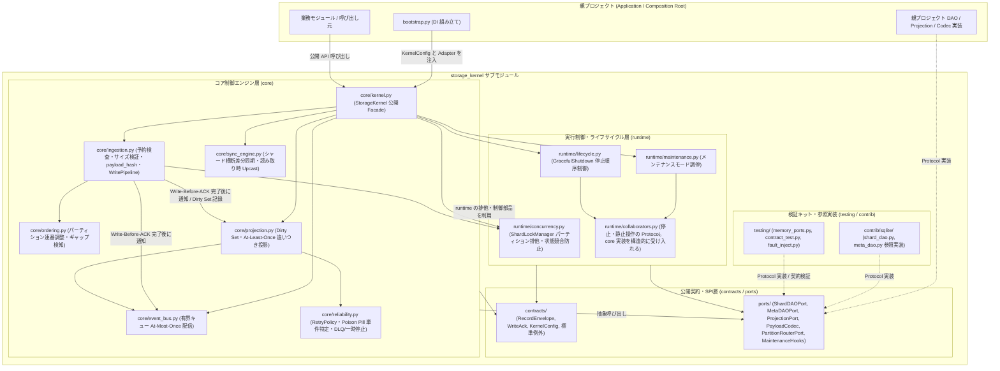

# 基本設計書（基本仕様・システム全体アーキテクチャ定義）
**storage_kernel 汎用ストレージ・同期カーネル基本設計（文書番号: DBF-BD-001）**

---

## 1. 概要と基本方針

### 1.1 システム目的と対象範囲

`storage_kernel` は、単一マシン上で複数モジュールが協調するローカルアプリケーション向けに、「パーティション単位の冪等書き込みと単調増加連番採番」「Write-Before-ACK による永続化保証」「インメモリ Event Bus（At-Most-Once）と非同期 Projection（At-Least-Once）の分離配信」「複数シャード横断のカーソル差分同期（Scatter-Gather）」を統一インターフェースとして提供する、外部依存ゼロの独立カーネルである。

具体的なテーブル構造・SQL・DB ドライバー（DAO）はすべて親プロジェクト側へ委譲し、Ports & Adapters（ヘキサゴナルアーキテクチャ）によって基盤コアと物理ストレージを完全に分離する（[`ADR-002`](../adr/ADR-002_DAO委譲とPython標準ライブラリによる独立カーネル構成.md)）。

- **対象範囲（v1）**:
  - 公開 API（`append`, `write_snapshot`, `subscribe`, `register_projection`, `resume_projection`, `set_partition_status`, `enter_maintenance`, `exit_maintenance`, `sync`, `close`）および契約型・例外体系（`contracts/`）。
  - 親プロジェクトが実装する抽象 Port 群（`ShardDAOPort`, `ShardTxPort`, `MetaDAOPort`, `ProjectionPort`, `DeadLetterPort`, `PayloadCodec`, `PayloadUpcaster`, `PartitionRouterPort`, `MaintenanceHooks`）。
  - 基盤コアの制御エンジン（`core/`）および実行制御・ライフサイクル管理（`runtime/`）。
  - 親プロジェクトの DAO が不変条件（13項目）を満たすか検証する Contract Test（`testing/contract_test.py`）、In-Memory 実装（`testing/memory_ports.py`）、および SQLite 参照実装（`contrib/sqlite/`）。
- **対象外範囲（v2 以降へ先送り、または親プロジェクトの責務）**:
  - **親プロジェクトの責務**: ドメイン固有のペイロード構造、本番用物理 DDL、サードパーティ製 DB ドライバーの管理、バックアップファイルの物理コピーと保管先管理。
  - **v2 以降の対象（v1 対象外）**: パーティション移動（`migrating` 状態・`Migratable*Port`）、大容量データの外部退避（`BlobStorePort`）、スナップショットの自動生成と古いログの自動削除（Retention・自動 VACUUM）、バッチ書き込み（`append_batch`）、揮発データストア（`core/ephemeral.py`）、アクセス制御・レート制限（`ports/guard.py`）、プロセス間通信・別言語配信口（`ports/transport.py`）（[`ADR-005`](../adr/ADR-005_v1スコープの限定と将来拡張に向けた前方互換契約の先行定義.md)）。
- **利用者・外部システム**:
  - **親プロジェクト（Application / Domain Modules）**: `StorageKernel` の公開 Facade を呼び出してイベントの追記・購読・同期を行う利用者であり、同時に `ports/` を満たす DAO Adapter を注入（DI）する提供者。
- **前提・制約**:
  - **プロセスモデル**: 単一プロセス・マルチスレッド（同一メモリ空間）。`ShardLockManager` や Event Bus キューはプロセス内でのみ有効である。通常運転中に別プロセスから物理 DB ファイルへ直接読み書きしないことは、親プロジェクトが守る制約とする（例外としてメンテナンスモード中のみバックアップ目的の別プロセス読み取りを許可する）。
  - **言語・依存・ライセンス**: Python `>=3.10`、標準ライブラリのみ（FFI 不採用）、Apache-2.0 ライセンス（[`DBF-ENV-001`](../setup/DBF-ENV-001_環境・開発基盤仕様書.md)）。
- **主要な非機能要件**: 下表に記載する。

| ID      | 区分                   | 要件                                              | 目標値・基準                                                                                                                                                                                                                                                                     | 測定方法・確認先                                                                                                             | 正本                                                          |
| :------ | :--------------------- | :------------------------------------------------ | :------------------------------------------------------------------------------------------------------------------------------------------------------------------------------------------------------------------------------------------------------------------------------- | :--------------------------------------------------------------------------------------------------------------------------- | :------------------------------------------------------------ |
| NFR-001 | 性能（スループット）   | 単件 `append()` による書き込み処理能力            | 定常 10〜50 writes/sec、バースト 500〜1,000 writes/sec 以上（`durability="power_loss"` 環境での実測確認済み許容値：代表値 481 B で 1,750 writes/sec 以上・p99 2.2 ms 以下、上限付近 60 KB で 930 writes/sec 以上・p99 2.8 ms 以下）                                              | 手動性能試験（Issue #7：`benchmarks/bench_storage_kernel.py`、[`DBF-TEST-001`](../test/DBF-TEST-001_性能検証結果報告書.md)） | 本書（`DBF-BD-001`）                                          |
| NFR-002 | 性能・容量（スケール） | パーティション数およびレコード保持規模            | パーティション数 10〜1,000、1パーティション最大 300,000 件（実測許容値：代表値 300,000 件のカーソル 0 からの `sync` 全件再生が 10 秒以内、実測 5.7〜6.2 秒・peak tracemalloc 3.4 MiB 以下。60 KB 大容量時は `limit_per_partition` を 100〜200 程度に抑えてメモリ消費を制御する） | 手動性能試験（Issue #7：[`DBF-TEST-001`](../test/DBF-TEST-001_性能検証結果報告書.md)）                                       | 本書（`DBF-BD-001`）                                          |
| NFR-003 | 容量制限（ペイロード） | 1レコードあたりのエンコード後ペイロードサイズ上限 | 最大 64 KB（65,536 bytes、スナップショットを含む）。超過時は `PayloadTooLarge` で即座に拒否する                                                                                                                                                                                  | 単体テストおよび Contract Test（`QG-004`）                                                                                   | 本書（`DBF-BD-001`） / `DBF-IF-001`                           |
| NFR-004 | 可用性・耐久性         | Write-Before-ACK の永続化保証水準                 | 既定および参照実装は `durability="power_loss"`（電源断耐性、SQLite `WAL` + `synchronous=FULL`）。DAO は自身の `durability` を自己申告し、COMMIT 完了後にのみ ACK とイベント配信を行う                                                                                            | Contract Test 項目1・2（`QG-004`）および起動時 telemetry 検査                                                                | 本書（`DBF-BD-001`） / `DBF-DS-001`                           |
| NFR-005 | 信頼性（配信・順序）   | パーティション内順序保証と取りこぼし対策          | パーティション単位の厳密な単調増加連番 `seq`（欠番・逆転なし）。`subscribe` は At-Most-Once（有界キュー）、`Projection` は At-Least-Once + `(partition_key, seq)` 冪等適用（Dirty Set と `fetch_range` で自動追いつき）                                                          | Contract Test 項目3〜10 およびユニットテスト（`QG-004`）                                                                     | 本書（`DBF-BD-001`） / `DBF-DD-002`                           |
| NFR-006 | 保守性・移植性         | 外部依存ゼロと静的型安全・契約検証                | 標準ライブラリのみ（外部依存 0 件）。`core/` から `contrib/` への依存禁止。品質ゲート `QG-001`〜`QG-006` の全件合格                                                                                                                                                              | CI 自動検証（`QG-001`〜`QG-006`）                                                                                            | [`DBF-ENV-001`](../setup/DBF-ENV-001_環境・開発基盤仕様書.md) |

品質ゲートの実行条件・合格基準は環境・開発基盤仕様書（[`DBF-ENV-001`](../setup/DBF-ENV-001_環境・開発基盤仕様書.md) 4.4節）を正本とし、表には参照先だけを記載する。テストケースと実行結果は再掲しない。

### 1.2 アーキテクチャ基本原則と課題解決

構想段階のプロトタイプ（`汎用データアクセスAPI層の構想.md` 第3章）および従来のアプリ直結型DBアクセスが抱えていた課題に対し、本アーキテクチャが採用した解決方針とトレードオフを下表に定義する。

| #    | 課題・ボトルネック                                                                                                              | 優先度 | 解決方針・選定技術                                                                                                                                                         | 選定理由・トレードオフ                                                                                                                                      | 担当コンポーネント                                               | 関連文書                                                                                    |
| :--- | :------------------------------------------------------------------------------------------------------------------------------ | :----: | :------------------------------------------------------------------------------------------------------------------------------------------------------------------------- | :---------------------------------------------------------------------------------------------------------------------------------------------------------- | :--------------------------------------------------------------- | :------------------------------------------------------------------------------------------ |
| 1    | 基盤が SQLite を直接操作すると親プロジェクトが独自スキーマや別DB（PostgreSQL等）を使えない                                      |   高   | Ports & Adapters による DAO 完全委譲と Python 標準ライブラリのみの純粋実装                                                                                                 | 外部ブローカーや FFI を排し `ports/` の Protocol 契約に限定することで、任意の DB エンジンとスキーマを親側で選択可能にする（親側で Adapter 実装が必要）      | `ports/`、`contracts/`、`core/`                                  | [`ADR-002`](../adr/ADR-002_DAO委譲とPython標準ライブラリによる独立カーネル構成.md)          |
| 2    | 単一インメモリキューでのイベント配信では、キュー溢れや遅い購読者によって Projection の欠落や全体停止が起きる                    |   高   | シャードDBとカーソルを Source of Truth とし、通知レーン（`subscribe`）と投影レーン（`ProjectionRunner` + Dirty Set）を完全分離                                             | `subscribe` は有界キュー＋ドロップ許容、`Projection` は Dirty Set と `fetch_range` による At-Least-Once 追いつきと Poison Pill 隔離（DLQ / 一時停止）を行う | `core/event_bus.py`、`core/projection.py`、`core/reliability.py` | [`ADR-003`](../adr/ADR-003_配信保証の2レーン分離とSource_of_Truth方針.md)                   |
| 3    | `synchronous=NORMAL` 等の暗黙設定により電源断で ACK 済みデータが消える、また `meta` と `shard` の更新不整合で孤児データが生じる |   高   | `durability` 自己申告（既定 `power_loss`）と、「`bind_shard` 先行確定 → 単一シャード `write_transaction`」の順序固定                                                       | 2PC を導入せず空パーティションを許容することで、ローカルトランザクションのみで孤児データ防止と電源断耐性を両立する                                          | `core/ingestion.py`、`ports/dao.py`                              | [`ADR-004`](../adr/ADR-004_耐久性レベルの自己申告方式とシャードバインド先行の原子性契約.md) |
| 4    | 同じ `idempotency_key` で異なる payload が送られた場合に、サイレントに既存レコードを返してしまう                                |   高   | 決定論的 `PayloadCodec.encode` と SHA-256 `payload_hash` の算出・比較による `IdempotencyConflict` 送出                                                                     | エンコードとハッシュ算出の微小な CPU コストと引き換えに、冪等キー使い回しバグによるデータ不整合を確実に検知する                                             | `core/ingestion.py`、`ports/codec.py`                            | [`ADR-004`](../adr/ADR-004_耐久性レベルの自己申告方式とシャードバインド先行の原子性契約.md) |
| 5    | 長期運用でペイロードのスキーマが変化した際、保存済みレコードの一括書き換えはリスクと停止時間が大きい                            |   中   | `RecordEnvelope.schema_version` と `PayloadUpcaster` による読み取り時バイト列 Upcast（1版ずつ変換）                                                                        | 保存済みレコードと `payload_hash` を一切書き換えず、読み取り・同期・Projection 時にメモリ上で最新版へ変換する                                               | `core/sync_engine.py`、`ports/codec.py`                          | [`ADR-005`](../adr/ADR-005_v1スコープの限定と将来拡張に向けた前方互換契約の先行定義.md)     |
| 6    | 未確定の高度な運用機能（パーティション移動、自動 Retention、Blob 退避）を初期から入れると Port 契約が肥大化する                 |   中   | v1 スコープを状態管理（`active`/`read_only`）・手動スナップショット・メンテナンスモードに絞り、将来 Major 更新を招く型（`__snapshot__`、`CursorExpiredError`）のみ先行定義 | v1 の DAO 実装と Contract Test を最小限に保ちつつ、v2 での Retention 追加時に `contracts/` の破壊的変更を防ぐ                                               | `contracts/`、`runtime/maintenance.py`                           | [`ADR-005`](../adr/ADR-005_v1スコープの限定と将来拡張に向けた前方互換契約の先行定義.md)     |

### 1.3 本書のSSOT範囲と文書境界

- **本書の正本範囲**: `system_architecture`。システム全体の目的、パッケージ構成、依存方向、プロセスモデル、想定規模、横断的な非機能・整合性方針、v1/v2 のスコープ境界を定義する。
- **IF/API仕様との境界**: 親プロジェクトとの境界を越える公開 API メソッド、Port（SPI）のシグネチャ・事前/事後条件、契約型・例外、Contract Test 13項目の要件は IF/API仕様書（`DBF-IF-001`）を正本とする。
- **詳細設計との境界**: `core/` および `runtime/` の各モジュール内部の制御フロー、内部 DTO、状態遷移条件、エラーハンドリング詳細、機能テスト要件（`TR-xxx`）は詳細設計書（`DBF-DD-001`〜`004`）を正本とする。
- **データ構造仕様との境界**: 永続化が求められる論理スキーマ（レコード、パーティション台帳、カーソル、Dead Letter）、状態分類、不変条件、耐久性・原子性契約、バックアップ対象はデータ構造仕様書（`DBF-DS-001`）を正本とする。
- **他文書との関係**: 環境・品質ゲートは [`DBF-ENV-001`](../setup/DBF-ENV-001_環境・開発基盤仕様書.md)、設計判断の理由は `ADR-002`〜`ADR-005` を正本とし、本書の方針を上書きしない。
- **全体ルール**: 文書分類、Frontmatter、ライフサイクル、矛盾時の解決は [`docs/README.md`](../README.md) を正本とする。

---

## 2. システム全体アーキテクチャとコンポーネント分離

### 2.1 全体構造とデータフロー (Mermaid アーキテクチャ図)

`storage_kernel` のレイヤー構造、コンポーネント間の呼び出し関係、および依存の向きを下図に示す。依存の向きは常に **`親プロジェクト` → `ports/`・`contracts/` ← `core/`・`runtime/`** に固定され、`core/`・`runtime/` は具象 DAO（親の Adapter や `contrib/sqlite/`）を一切関知しない。`core/` から `runtime/` への依存は許可し、`runtime/` から `core/` への依存は禁止する（`runtime/` は停止・静止に必要な操作を `runtime/collaborators.py` の Protocol で受け取り、`core/kernel.py` が `core/` の実装を注入する）。

### 2.2 コンポーネント責務マッピング

各パッケージ・コンポーネントの責務範囲、依存方向、公開インターフェース、および対応する正本設計書を下表に定義する。コンポーネント間の循環依存は一切許可しない。

| コンポーネントID | コンポーネント名                                                                                       | 担当領域・主要責務                                                                                                                                                                                                                                                | 依存先・依存方向 / 公開インターフェース                                                                                                                                                                                | 関連詳細設計書（文書番号・相対リンク）                                                                   |
| :--------------- | :----------------------------------------------------------------------------------------------------- | :---------------------------------------------------------------------------------------------------------------------------------------------------------------------------------------------------------------------------------------------------------------- | :--------------------------------------------------------------------------------------------------------------------------------------------------------------------------------------------------------------------- | :------------------------------------------------------------------------------------------------------- |
| C-001            | `contracts/` (`envelope.py`, `errors.py`, `telemetry.py`)                                              | 基盤と親プロジェクトが共有する不変 DTO（`RecordEnvelope[T]`, `WriteAck[T]`, `PartitionInfo`, `KernelConfig`, `DeadLetterRecord[T]`, `ShutdownReport`, `SubscriptionHandle`）、標準例外体系、telemetry イベント型の定義                                            | 標準ライブラリのみに依存。全レイヤーから参照される最下層契約                                                                                                                                                           | `DBF-IF-001`（外部公開契約） / `DBF-DS-001`（論理データ構造）                                            |
| C-002            | `ports/` (`dao.py`, `codec.py`, `router.py`, `maintenance.py`)                                         | 親プロジェクトが実装する SPI（`ShardDAOPort`, `ShardTxPort`, `MetaDAOPort`, `ProjectionPort`, `DeadLetterPort`, `PayloadCodec`, `PayloadUpcaster`, `PartitionRouterPort`, `MaintenanceHooks`）の Protocol と不変条件の定義                                        | `contracts/` および標準ライブラリのみに依存                                                                                                                                                                            | `DBF-IF-001`（外部公開契約）                                                                             |
| C-003            | `core/kernel.py`, `core/ingestion.py`, `core/ordering.py`                                              | 公開 Facade（`StorageKernel`）、書き込みパイプライン（予約種別検査、サイズ64KB検証、`payload_hash` 算出、`bind_shard` 先行確定、単一シャードトランザクション内での冪等性確認・採番・永続化、Write-Before-ACK）、手動スナップショット書き込み                      | `contracts/`, `ports/`, `runtime/` に依存。公開 API `append`, `write_snapshot`, `set_partition_status` を提供                                                                                                          | `DBF-DD-001`（書き込み経路詳細設計書）                                                                   |
| C-004            | `core/event_bus.py`, `core/projection.py`, `core/reliability.py`                                       | パターンマッチ（完全一致・`*`・末尾ワイルドカード）、購読者別有界キューと `drop_policy` による At-Most-Once 通知、Dirty Set と `fetch_range` による At-Least-Once 追いつき投影、指数バックオフ再試行、Poison Pill 単件特定、DLQ隔離・パーティション一時停止と再開 | `contracts/`, `ports/` および `core/` 内の `event_bus.py`・`reliability.py` に依存（`runtime/` には依存しない）。公開 API `subscribe`, `register_projection`, `resume_projection` を提供                               | `DBF-DD-002`（配信とProjection詳細設計書）                                                               |
| C-005            | `core/sync_engine.py`                                                                                  | `{partition_key: last_seen_seq}` カーソルマップに基づく複数シャード横断の Scatter-Gather 差分取得、`PayloadUpcaster` による読み取り時バイト列 Upcast（1版ずつ変換）とデコード、スキーマ版整合性検証                                                               | `contracts/`, `ports/` に依存。公開 API `sync` を提供                                                                                                                                                                  | `DBF-DD-003`（同期と版管理詳細設計書）                                                                   |
| C-006            | `runtime/concurrency.py`, `runtime/maintenance.py`, `runtime/lifecycle.py`, `runtime/collaborators.py` | パーティション単位ロックによる書き込みと状態変更（`active`/`read_only`）の競合防止、ルーティングキャッシュ管理、メンテナンスモード（新規更新遮断・進行中Tx待機・フック呼び出し）、`close()` の段階的グレースフルシャットダウン                                    | `contracts/`, `ports/` にだけ依存し、`core/` を import しない（Projection・Subscriber の停止と静止は `collaborators.py` の Protocol 経由）。公開 API `enter_maintenance`, `exit_maintenance`, `close` を支える実行制御 | `DBF-DD-004`（実行制御詳細設計書）                                                                       |
| C-007            | `testing/` (`memory_ports.py`, `contract_test.py`, `fault_inject.py`)                                  | DB不要の In-Memory Port 実装（`durability="none"`）、親プロジェクトの DAO が13項目の不変条件を満たすか検証する `unittest` ベースの契約テスト基底クラス、重複・遅延・例外を注入するテストハーネス                                                                  | `contracts/`, `ports/` および標準ライブラリ（`unittest`）のみに依存                                                                                                                                                    | `DBF-IF-001`（第6章 外部契約テスト要件） / [`DBF-ENV-001`](../setup/DBF-ENV-001_環境・開発基盤仕様書.md) |
| C-008            | `contrib/sqlite/` (`shard_dao.py`, `meta_dao.py`)                                                      | 標準ライブラリ `sqlite3` のみを用いた外部依存ゼロの参照 DAO 実装（`WAL` + `synchronous=FULL`, `durability="power_loss"`、`DuplicateKeyError` への例外変換）。CI での実 DB 契約検証および親プロジェクトの実装見本                                                  | `contracts/`, `ports/` および標準ライブラリ（`sqlite3`）に依存。**`core/`・`runtime/` からは一切 import しない**                                                                                                       | `DBF-DS-001`（参照物理スキーマ） / `DBF-IF-001`                                                          |

---

## 3. 動作前提およびシステム境界

### 3.1 実行前提環境

- **対応OS**: Linux、macOS、Windows（Python 標準ライブラリが動作する環境）。
- **ランタイム要件**: Python `>=3.10`（標準開発環境は Python `3.12`）。
- **依存管理・パッケージマネージャーの正本**: `uv` および `pyproject.toml`。詳細は環境・開発基盤仕様書（[`DBF-ENV-001`](../setup/DBF-ENV-001_環境・開発基盤仕様書.md)）を正本とする。
- **外部依存ツール**: 本番実行時の外部依存パッケージはゼロ（標準ライブラリのみ）。
- **実行エントリポイント**: 独立した CLI やデーモンプロセスを持たず、親プロジェクトの Composition Root（`bootstrap.py` 等）から `StorageKernel` クラスをインスタンス化して同一プロセス内で呼び出す。環境変数や外部設定ファイルの暗黙読み込みは行わず、`KernelConfig` で明示注入する。
- **品質目標・品質ゲート**: コード品質、型安全性（`mypy` strict）、Contract Test 13項目と単体・境界テスト、ドキュメントおよび Mermaid 図の検証を必須とする。品質ゲートの実行条件・合格基準は環境・開発基盤仕様書（[`DBF-ENV-001`](../setup/DBF-ENV-001_環境・開発基盤仕様書.md) 4.4節 `QG-001`〜`QG-006`）を正本とする。

### 3.2 安全回路・システム境界方針

- **外部アクター・外部システム**:
  - 境界の外側にあるのは「親プロジェクトの業務ロジック（API 呼び出し元）」と「親プロジェクトが提供する Adapter 群（DAO / Projection / Codec / Router / MaintenanceHooks）」である。
- **入出力と信頼境界**:
  - 親プロジェクトから渡される `record_type`、`schema_version`、`payload`、`covers_through_seq` は境界入り口（`core/ingestion.py`）で厳密に検査する。
  - `"__"` で始まる `record_type` の通常 `append` は `ReservedRecordTypeError` で拒否し、`KernelConfig.schema_registry` の最新版と一致しない `schema_version` は `SchemaVersionError` で拒否し、エンコード後 64 KB を超えるペイロードは `PayloadTooLarge` で拒否する。
  - 読み取り・同期時は、未知の新しい `schema_version` や変換経路欠落を推測せず `SchemaVersionError` で拒否する。
  - DAO 内部で発生した DB ドライバー固有の一意制約違反は、境界を越える前に DAO 側で `DuplicateKeyError` に変換して送出させる。
- **認証・認可境界**:
  - v1 は単一プロセス・ローカルアプリ内のインプロセス呼び出しに限定されるため、カーネル内部での認証・ACL・レート制限（`ports/guard.py`）は行わない（[`ADR-005`](../adr/ADR-005_v1スコープの限定と将来拡張に向けた前方互換契約の先行定義.md)）。プロセス外部からの入力に対する認証・認可は親プロジェクトの責務とする。
- **タイムアウトと再試行制御**:
  - **Projection 再試行**: `ProjectionPort.apply_batch` 失敗時は `RetryPolicy`（既定 `max_attempts=3`, `initial_delay_sec=0.1`, `backoff_multiplier=2.0`, `max_delay_sec=5.0`）に従って指数バックオフ再試行を行う。上限到達時はバッチを1件ずつ再実行して Poison Pill を特定し、`dlq_and_skip`（DLQ隔離＋カーソル進行）または `pause_partition`（該当パーティションの投影のみ一時停止）で無限ループを防ぐ。
  - **Subscribe 通知**: At-Most-Once のため再試行しない。有界キュー（既定 256 件）が溢れた場合は `drop_policy`（`drop_newest` / `drop_oldest` / `disconnect`）により即座に処理し、書き込みや他購読者をブロックしない。
  - **メンテナンス・終了待機**: `enter_maintenance(timeout=30.0)` および `close(timeout=5.0)` は明示的なタイムアウト上限を持ち、超過時はハングアップせず例外または `ShutdownReport`（`completed_cleanly=False`）を返して制御を戻す。
- **排他制御・競合防止**:
  - パーティション単位のロック（`ShardLockManager`）により、同一パーティションに対する「状態確認（`active` / `read_only`）＋書き込み」と「状態変更（`set_partition_status`）」を直列化し、`read_only` 遷移完了後の書き込み混入を防止する。
  - `set_partition_status` は `expected_status` による楽観的排他（CAS）をサポートし、不一致時は `PartitionStateConflictError` を送出する。
  - `MetaDAOPort.bind_shard` は並行呼び出しに対して冪等かつ不変（最初の `shard_id` を維持）とし、`MetaDAOPort.advance_cursor` は単調非減少（`MAX(current, seq)`）を強制する。
- **失敗時保全契約**:
  - **ロールバック原子性**: `ShardDAOPort.write_transaction` 内で例外が発生した場合、レコード挿入と `seq` の採番増分はともにロールバックされ、欠番や半端なレコードを残さない。
  - **孤児データ防止**: `bind_shard` を先に確定してからシャード書き込みを行うため、`meta` に存在しない孤児シャードデータは一切発生しない（書き込み失敗時に残る空パーティションは安全に再利用される）。
  - **原本データ不変性**: 読み取り時の Upcast はメモリ上のバイト列に対してのみ行い、ストレージ上の保存済みレコードと `payload_hash` は決して書き換えない。
  - **バックアップ整合点**: バックアップ取得時は `enter_maintenance` で新規書き込み・パーティション作成・状態変更・カーソル更新を `KernelMaintenanceError` で遮断し、進行中トランザクション完了後に `MaintenanceHooks.on_enter_maintenance` を呼び出すことで、メタDBと全シャードDBの世代が完全に一致した整合点を作る。
- **機密情報・監査ログ方針**:
  - 基盤のログおよび telemetry イベントには、`partition_key`、`seq`、`shard_id`、`record_type`、`schema_version`、`durability`、ドロップ件数、エラー種別のみを記録し、業務データを含む `payload` 本体はログへ出力しない。

---

## 4. 基本設計における変更管理方針

- **拡張時のルール**:
  - `core/` および `runtime/` に新機能を追加する際も、標準ライブラリ以外の外部依存を追加してはならず、具象 DAO（`contrib/sqlite/` を含む）を import してはならない。
  - 将来 `append_batch()` を追加する場合は、既存の `ShardTxPort`（`find_by_idempotency` / `next_sequence` / `insert_record`）を1つの `write_transaction` 内で繰り返す形で実装し、`ports/` の破壊的変更を避ける。また、原子性の保証範囲は同一パーティション内に限定する（Issue #6）。
  - `ports/` および `contracts/` の変更はセマンティックバージョニングの Major 更新対象となるため、変更時は必ず ADR を起票して親プロジェクトへの影響と移行手順を評価する。
- **仕様の決定権 (SSOT)**:
  - 基本設計方針は本書（`DBF-BD-001`）を正本とし、外部公開 API・Port 契約は `DBF-IF-001`、内部モジュール制御・DTO・状態遷移は `DBF-DD-001`〜`004`、永続化論理スキーマは `DBF-DS-001`、環境・品質ゲートは [`DBF-ENV-001`](../setup/DBF-ENV-001_環境・開発基盤仕様書.md) を正本とする。文書全体の分類・ライフサイクルは [`docs/README.md`](../README.md) を参照する。
- **変更影響の確認方法**:
  1. 変更対象の `ssot_scope` を特定し、対応する正本設計書を最初に更新する。
  2. `DBF-IF-001` の IF-ID と `DBF-DD-001`〜`004` の機能 ID（`F-xxx`）・機能テスト要件（`TR-xxx`）の対応関係に漏れがないか確認する。
  3. 品質ゲート `QG-005`（`validate_docs.py`）および `QG-006`（Mermaid 検証）を実行してリンク切れや構文エラーがないことを確認する。

---

## 5. 作成完了チェック

- [x] 対象範囲・対象外範囲・利用者・前提を記入した。
- [x] 主要な非機能要件を表に記入し、各要件に目標値・測定方法・正本を設定した（品質ゲートは参照のみ）。
- [x] `document_role`、`ssot_scope`、`status`、`owner`をFrontmatterへ設定した。
- [x] 課題ごとに優先度、選定理由、トレードオフ、担当、関連文書を記入した。
- [x] Mermaid図のサンプル名・仮ラベルを実際の構成へ置換した。
- [x] 全コンポーネントの責務、依存方向、公開インターフェース、詳細設計書リンクを記入した。
- [x] 実行環境、依存管理の正本、品質目標と品質ゲートの参照先（環境・開発基盤仕様書）を記入した。
- [x] 外部システム、信頼境界、認証・認可、失敗時保全を記入した。
- [x] 未置換の `[ ... ]`、`YYYY-MM-DD`、サンプル固有名が残っていない。

---

## 6. 改訂履歴 (Change Log)

| 版数    | 改訂日     | 変更者 | 変更内容・変更理由 (Why)                                                                                           |
| :------ | :--------- | :----- | :----------------------------------------------------------------------------------------------------------------- |
| Rev.1.0 | 2026-11-19 | xzyozi | 新規作成（Issue #11 に基づき storage_kernel v1 の基本設計書を初版制定）                                            |
| Rev.1.1 | 2026-11-20 | xzyozi | Issue #7 性能検証（`DBF-TEST-001`）の実測結果に基づき `NFR-001`・`NFR-002` の許容値を確定                          |
| Rev.1.2 | 2026-11-20 | xzyozi | Issue #37 に基づき runtime から core への依存を解消し、C-004・C-006 の依存記述と §2.1 の図を実装に合わせて修正     |
| Rev.1.3 | 2026-11-20 | xzyozi | v1.0.0 リリース準備に伴い、状態を `draft` から `approved` へ変更（実装・レビュー・性能検証を経て現在の正本とする） |
