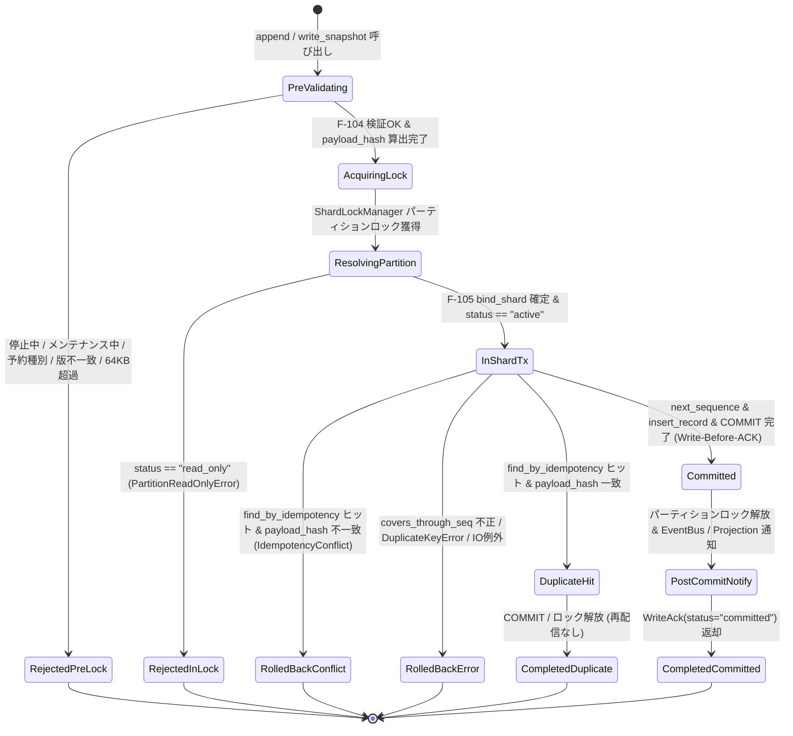
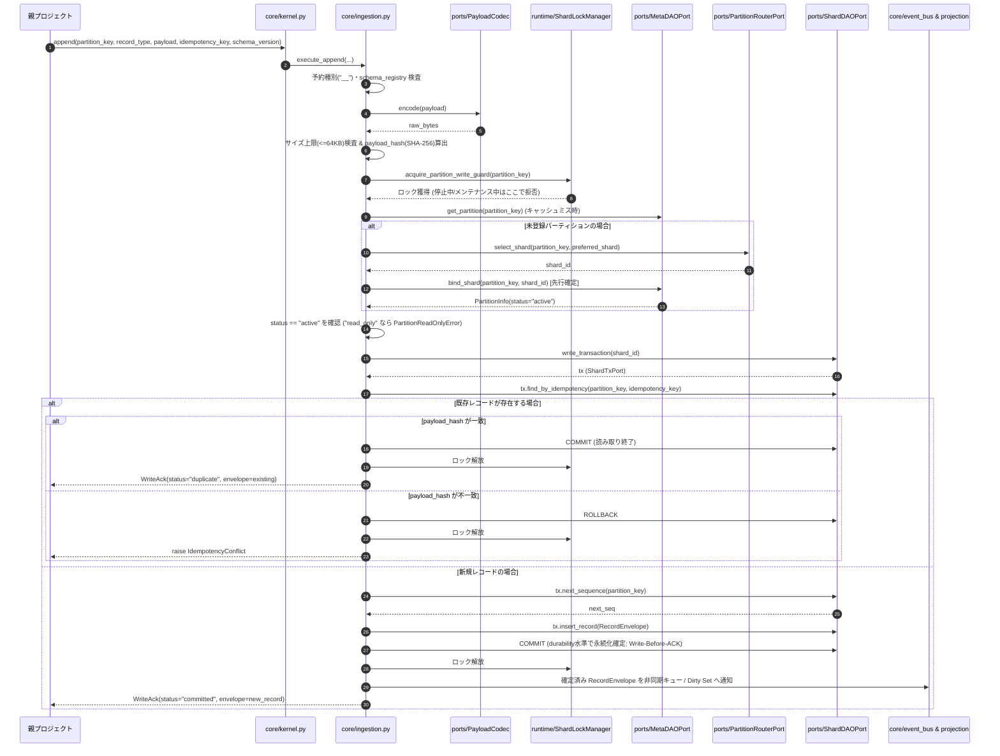

# 詳細設計書（機能・モジュール制御仕様）
**storage_kernel 書き込み経路（`core/kernel.py`・`core/ingestion.py`・`core/ordering.py`）制御仕様（文書番号: DBF-DD-001）**

---

## 1. 概要とSSOT境界

### 1.1 モジュールの目的

本モジュール群（`core/kernel.py` の書き込み系エントリポイント、`core/ingestion.py` の `WritePipeline`、`core/ordering.py` の `SequenceCoordinator`）は、親プロジェクトから要求されたレコード追記（`append`）、手動スナップショット保存（`write_snapshot`）、およびパーティション状態変更（`set_partition_status`）を制御する。

具体的には、システム予約種別（`"__"` 始まり）の保護、スキーマ版の一致確認、64 KB ペイロードサイズ上限検査、長さプレフィックス付き SHA-256 による `payload_hash` の決定論的算出、2PC を用いない `MetaDAOPort.bind_shard` の先行確定、パーティション単位ロック下での状態（`active` / `read_only`）確認、単一シャード `write_transaction` 内での「冪等性確認 → 単調増加採番 → 永続化（Write-Before-ACK）」、および COMMIT 完了後の非同期配信レーンへの投入を担う。

### 1.2 単一責任範囲 (SSOT) とデータ境界

- **本書の正本範囲**: `module_behavior`。書き込み経路（`core/kernel.py`, `core/ingestion.py`, `core/ordering.py`）の関数呼び出し順序、内部 DTO、制御フロー、状態遷移、エラー処理契約、および機能テスト要件（`TR-DD1-001`〜`008`）の正本とする。
- **データ境界 (DTO vs DAO)**: 本書は書き込みパイプライン内部で受け渡す DTO（`PreparedWriteRequest[T]`, `SequenceCheckResult` 等）を管理する。ストレージ永続化スキーマと不変条件はデータ構造仕様書（[`DBF-DS-001`](./DBF-DS-001_データ構造仕様書.md)）を参照する。
- **BDとの関係**: システム全体のアーキテクチャ境界と非機能方針は基本設計書（[`DBF-BD-001`](./DBF-BD-001_基本設計書.md)）を正本とし、本書はコンポーネント `C-003` を機能単位へ具体化する。
- **他文書との関係**: 要求、環境、運用、テスト、ADR、レビュー文書はそれぞれの `ssot_scope` を正本とし、本書の制御仕様を上書きしない。
- **他文書へ委譲する情報**: 品質ゲート（静的解析・型検査・テストの実行条件と合格基準）は環境・開発基盤仕様書（[`DBF-ENV-001`](../setup/DBF-ENV-001_環境・開発基盤仕様書.md)）、テストケース・実行結果・証跡はテスト計画・結果報告書を正本とし、本書へ再掲しない。
- **外部公開契約**: 親プロジェクト向けの公開 API シグネチャと Port 契約は IF/API仕様書（[`DBF-IF-001`](./DBF-IF-001_IF仕様書.md)）を正本とし、本書 2.1 節の対象機能一覧にて公開範囲を「外部公開」とした機能は IF-ID（`IF-001`, `IF-002`, `IF-006`）で対応付ける。
- **責務の対象外**: COMMIT 完了後の `EventDispatcher` / `ProjectionRunner` 内部のキュー配送・リトライ制御は `DBF-DD-002`、パーティションロックやメンテナンスバリアの排他機構そのものは `DBF-DD-004` へ委譲する。
- **矛盾時の扱い**: 文書の更新日ではなく、該当する `ssot_scope` の正本を更新し、関連文書を追従させる。

---

## 2. インターフェースと DTO (Data Transfer Object) 仕様

### 2.1 対象機能一覧

| 機能ID | 関数・機能名 | 呼び出し元 | 主な呼び出し先 | 同期 / 非同期 | 冪等性 | 外部副作用 | 公開範囲 |
| :--- | :--- | :--- | :--- | :---: | :---: | :--- | :---: |
| F-101 | `StorageKernel.append` / `WritePipeline.execute_append` | 親プロジェクト業務モジュール | `F-104`, `ShardLockManager`, `F-105`, `ShardDAOPort.write_transaction`, `F-106`, `EventDispatcher`, `ProjectionRunner` | 同期 | あり（同一冪等キー・同一ハッシュ時） | `MetaDAOPort.bind_shard`, `ShardTxPort.insert_record`, 配信キュー投入 | 外部公開（`IF-001`） |
| F-102 | `StorageKernel.write_snapshot` / `WritePipeline.execute_snapshot` | 親プロジェクト業務モジュール | `F-104`, `ShardLockManager`, `F-105`, `ShardDAOPort.write_transaction`, `F-106`, `ProjectionRunner` | 同期 | あり（同一冪等キー・同一ハッシュ時） | `ShardTxPort.insert_record`, スナップショット対応 Projection への通知 | 外部公開（`IF-002`） |
| F-103 | `StorageKernel.set_partition_status` | 親プロジェクト運用・管理機能 | `ShardLockManager` (`DBF-DD-004` `F-401`), `MetaDAOPort.set_partition_status` | 同期 | 条件付き（`expected_status=None` 時） | `MetaDAOPort` の状態更新、ルーティングキャッシュ更新 | 外部公開（`IF-006`） |
| F-104 | `WritePipeline.prepare_and_hash` | `F-101`, `F-102` | `PayloadCodec.encode`, `hashlib.sha256` | 同期 | あり（純粋関数） | なし（メモリ上の検証とハッシュ算出のみ） | 内部 |
| F-105 | `WritePipeline.resolve_and_bind_partition` | `F-101`, `F-102` | `MetaDAOPort.get_partition`, `PartitionRouterPort.select_shard`, `MetaDAOPort.bind_shard` | 同期 | あり（`bind_shard` は冪等・不変） | 未登録パーティションの `MetaDAOPort` 登録とキャッシュ格納 | 内部 |
| F-106 | `SequenceCoordinator.allocate_and_verify` | `F-101`, `F-102` | `ShardTxPort.next_sequence` | 同期 | なし（呼び出しごとに `+1` 採番） | トランザクション内での `PARTITION_SEQUENCE` 更新 | 内部 |

### 2.2 主要関数・機能の契約

#### 機能契約（機能ID: F-101 `append` / `WritePipeline.execute_append`）

- **対象機能・関数名**: `StorageKernel.append` → `WritePipeline.execute_append`
- **機能概要**: 通常レコードの書き込み要求を受け取り、入力検証・`payload_hash` 算出（`F-104`）を行った後、パーティションロックを獲得してシャードバインドと状態（`active`）を確認（`F-105`）し、単一シャードの `write_transaction` 内で冪等性確認・採番（`F-106`）・レコード挿入を原子的に完了させてから、新規コミット時のみ Event Bus と Projection へ非同期通知して `WriteAck[T]` を返す。
- **事前条件 (Pre-conditions)**: カーネルが稼働中（`RUNNING`）であり、メンテナンスモード中でも停止処理中でもないこと。`record_type` が `"__"` で始まらないこと。
- **事後条件 (Post-conditions)**:
  - 新規書き込み時：`MetaDAOPort` にパーティションが登録され、`ShardDAOPort` にレコードが COMMIT された後に `WriteAck(status="committed")` が返る。
  - 重複再送時（同一 `partition_key`, `idempotency_key`, `payload_hash`）：`seq` は進まず、既存レコードを保持した `WriteAck(status="duplicate")` が返り、下流へのイベント再配信は行われない。
- **タイムアウト / キャンセル**: DB トランザクションのロック待機タイムアウトは親の DAO 設定に従う。例外発生時はトランザクション全体がロールバックされる。
- **ログ・メトリクス・相関ID**: `partition_key`, `idempotency_key`, `shard_id`, `seq`, `status`（`committed` / `duplicate`）, 処理時間（ms）を telemetry に記録する（`payload` 本体は出力しない）。
- **外部公開時の互換性・認証**: 外部公開契約の詳細は [`DBF-IF-001`](./DBF-IF-001_IF仕様書.md) 4.1節（`IF-001`）を参照。

#### 機能契約（機能ID: F-102 `write_snapshot` / `WritePipeline.execute_snapshot`）

- **対象機能・関数名**: `StorageKernel.write_snapshot` → `WritePipeline.execute_snapshot`
- **機能概要**: 親プロジェクトが作成した集約スナップショットを、システム予約種別 `record_type="__snapshot__"` として書き込む。トランザクション内で `1 <= covers_through_seq <= 現在の最終 seq`（採番直前の最新 `seq`）であることを検証し、COMMIT 後は `include_snapshots=True` の Projection にのみ通知する（通常の `subscribe` には配信しない）。
- **事前条件 (Pre-conditions)**: カーネルが稼働中（`RUNNING`）であること。対象パーティションに1件以上のレコードが存在し、`covers_through_seq` がその最終 `seq` 以下であること。
- **事後条件 (Post-conditions)**: `record_type="__snapshot__"`, `covers_through_seq` 設定済みの `RecordEnvelope[T]` が新しい `seq` で永続化され、`WriteAck[T]` が返る。
- **タイムアウト / キャンセル**: `F-101` と同一。
- **ログ・メトリクス・相関ID**: `F-101` の記録項目に加え、`covers_through_seq` を telemetry に記録する。
- **外部公開時の互換性・認証**: 外部公開契約の詳細は [`DBF-IF-001`](./DBF-IF-001_IF仕様書.md) 4.2節（`IF-002`）を参照。

#### 機能契約（機能ID: F-103 `set_partition_status`）

- **対象機能・関数名**: `StorageKernel.set_partition_status`
- **機能概要**: `ShardLockManager` で対象 `partition_key` の排他ロックを獲得した状態で `MetaDAOPort.set_partition_status` を呼び出し、ルーティングキャッシュ内の `PartitionInfo` をアトミックに更新する。
- **事前条件 (Pre-conditions)**: カーネルが稼働中（`RUNNING`）であり、対象 `partition_key` が登録済みであること。
- **事後条件 (Post-conditions)**: パーティションロック解放後、新しい `status`（例: `"read_only"`）が直ちにすべての後続 `append` / `write_snapshot` に反映される。
- **タイムアウト / キャンセル**: パーティションロック獲得まで同期的に待機する。
- **ログ・メトリクス・相関ID**: `partition_key`, 変更前後の `status` をログおよび telemetry に記録する。
- **外部公開時の互換性・認証**: 外部公開契約の詳細は [`DBF-IF-001`](./DBF-IF-001_IF仕様書.md) 4.5節（`IF-006`）を参照。

#### 機能契約（機能ID: F-104 `WritePipeline.prepare_and_hash`）

- **対象機能・関数名**: `WritePipeline.prepare_and_hash`
- **機能概要**: ロック獲得前に実行可能な入力検査と決定論的ハッシュ算出を行う。
  1. 通常 `append` 時は `record_type.startswith("__")` を検査し、真なら `ReservedRecordTypeError` を送出する。
  2. `KernelConfig.schema_registry.get(record_type)` を照会し、未登録または `schema_version != registered_version` なら `SchemaVersionError` を送出する。
  3. `raw_bytes = PayloadCodec.encode(payload)` を実行し、`len(raw_bytes) > KernelConfig.max_payload_bytes`（64 KB）なら `PayloadTooLarge(len(raw_bytes), max_payload_bytes)` を送出する。
  4. 境界衝突を防ぐため、`record_type`（UTF-8 バイト列）、`schema_version`（ASCII 10進バイト列）、`raw_bytes` の3要素をそれぞれ「バイト長（10進ASCII）＋コロン `:` ＋本体バイト列」の長さプレフィックス形式で連結し、SHA-256 の小文字16進文字列（64文字）として `payload_hash` を算出する。
- **事前条件 (Pre-conditions)**: `PayloadCodec.encode` が決定論的であること。
- **事後条件 (Post-conditions)**: 検証済みの内部 DTO `PreparedWriteRequest[T]` を返す。失敗時はロックや DB に一切触れずに例外を送出する。
- **タイムアウト / キャンセル**: インメモリ計算のみのため該当なし。
- **ログ・メトリクス・相関ID**: サイズ超過や予約種別違反時にエラーイベントを記録する。

#### 機能契約（機能ID: F-105 `WritePipeline.resolve_and_bind_partition`）

- **対象機能・関数名**: `WritePipeline.resolve_and_bind_partition`
- **機能概要**: 対象パーティションのロック保持下でルーティングキャッシュを照会し、未キャッシュなら `MetaDAOPort.get_partition(partition_key)` を引く。未登録なら `PartitionRouterPort.select_shard(partition_key, preferred_shard=preferred_shard)` で格納先を決定し、**シャード書き込みより先に `MetaDAOPort.bind_shard(partition_key, shard_id)` を確定**させてキャッシュへ保存する。取得または登録された `PartitionInfo.status == "read_only"` の場合は `PartitionReadOnlyError` を送出する。
- **事前条件 (Pre-conditions)**: 呼び出しスレッドが `ShardLockManager` の対象 `partition_key` ロックと通常運転ガードを保持していること。
- **事後条件 (Post-conditions)**: `status == "active"` が確認された `PartitionInfo` を返し、メタDBへのバインドが完了していることを保証する（孤児データの防止）。
- **タイムアウト / キャンセル**: `MetaDAOPort` の応答に従う。
- **ログ・メトリクス・相関ID**: 新規バインド発生時に `partition_key`, `shard_id` を記録する。

#### 機能契約（機能ID: F-106 `SequenceCoordinator.allocate_and_verify`）

- **対象機能・関数名**: `SequenceCoordinator.allocate_and_verify`
- **機能概要**: `ShardTxPort.next_sequence(partition_key)` を呼び出して新しい連番 `next_seq` を取得し、直前に把握している最終連番より厳密に大きいこと（`next_seq >= 1`）およびスナップショット書き込み時は `1 <= covers_through_seq <= next_seq - 1`（直前までの確定済み `seq` 以下）であることを検証する。
- **事前条件 (Pre-conditions)**: `ShardDAOPort.write_transaction` のコンテキスト内であること。
- **事後条件 (Post-conditions)**: 検証済みの `next_seq` を返す。`covers_through_seq` が不正（まだ存在しない未来の `seq` や `0` 以下）の場合は `ValueError` を送出してトランザクションをロールバックさせる。
- **タイムアウト / キャンセル**: トランザクションコンテキストに従う。
- **ログ・メトリクス・相関ID**: 連番逆転や不正 `covers_through_seq` 検出時にエラーログを記録する。

### 2.3 入力 DTO スキーマ・パラメータ仕様

外部公開 API（`F-101`, `F-102`, `F-103`）の入力引数は [`DBF-IF-001`](./DBF-IF-001_IF仕様書.md) 第4章を正本とする。ここではモジュール内部で受け渡す内部 DTO を定義する。

- **対象機能ID**: `F-104`, `F-105`, `F-106`（内部 DTO `PreparedWriteRequest[T]`）

| パラメータ名 / フィールド | データ型 | 必須性 | NULL可 | デフォルト値 | バリデーションルール・入力制約 | 例・備考 |
| :--- | :--- | :---: | :---: | :--- | :--- | :--- |
| `partition_key` | `str` | 必須 | 不可 | なし | 非空 UTF-8 文字列 | `"order:usdjpy"` |
| `record_type` | `str` | 必須 | 不可 | なし | `is_snapshot=False` 時は `"__"` 非開始、`is_snapshot=True` 時は `"__snapshot__"` | `"tick_signal"` / `"__snapshot__"` |
| `schema_version` | `int` | 必須 | 不可 | なし | `schema_registry[record_type]` と一致する正の整数 | `1` |
| `idempotency_key` | `str` | 必須 | 不可 | なし | 非空文字列 | UUID 文字列 |
| `payload` | `T` | 必須 | 可 | なし | ドメインオブジェクト | 元のペイロード参照 |
| `raw_payload` | `bytes` | 必須 | 不可 | なし | `len(raw_payload) <= max_payload_bytes`（65,536 bytes） | `PayloadCodec.encode(payload)` の結果 |
| `payload_hash` | `str` | 必須 | 不可 | なし | 64文字の16進文字列（SHA-256） | 長さプレフィックス連結ハッシュ |
| `covers_through_seq` | `int \| None` | 任意 | 可 | `None` | スナップショット時のみ必須（`>= 1`） | `1000` |
| `preferred_shard` | `str \| None` | 任意 | 可 | `None` | 初回バインド時のみ参照されるシャードヒント | `"shard_heavy"` |
| `is_snapshot` | `bool` | 必須 | 不可 | `False` | スナップショット書き込み経路の識別フラグ | `False` / `True` |

### 2.4 出力 DTO スキーマ・戻り値仕様

- **対象機能ID**: `F-101`, `F-102`
- **正常時の戻り値 DTO**: `WriteAck[T]`（外部公開契約は [`DBF-IF-001`](./DBF-IF-001_IF仕様書.md) 2.3節を参照）。内部パイプライン完了時は以下の `WritePipelineResult[T]` を生成し、Facade が `WriteAck[T]` を取り出して返す。

| フィールド | データ型 | 必須性 | NULL可 | 正常時の意味・制約 |
| :--- | :--- | :---: | :---: | :--- |
| `ack` | `WriteAck[T]` | 必須 | 不可 | `status`（`"committed"` または `"duplicate"`）、`shard_id`、`envelope` |
| `should_dispatch_event` | `bool` | 必須 | 不可 | `status == "committed"` のときのみ `True`（`"duplicate"` 時は再配信しない） |
| `is_snapshot` | `bool` | 必須 | 不可 | `True` の場合は通常 `subscribe` への配信をスキップし、`include_snapshots=True` の Projection のみへ通知する |

- **異常時の戻り値 / 例外**: `KernelClosedError`, `KernelMaintenanceError`, `ReservedRecordTypeError`, `SchemaVersionError`, `PayloadTooLarge`, `PartitionReadOnlyError`, `IdempotencyConflict`, `DuplicateKeyError`, `ValueError`。
- **再試行可否**: `KernelMaintenanceError` および一時的な DB ロック競合時は同一 `idempotency_key` で安全に再試行可能。バリデーション系例外（`PayloadTooLarge`, `ReservedRecordTypeError`, `IdempotencyConflict` 等）は再試行不可。
- **相関ID・監査情報**: `idempotency_key` および確定後の `(partition_key, seq)`。

---

## 3. 処理フロー・シーケンス・状態遷移ロジック (Mermaid 図)

### 3.1 処理フロー・シーケンス / 状態遷移図

- **図の正本**: 状態遷移表（3.2節）および下記のシーケンス図・状態遷移図を併用して正本とする。
- **対象機能ID**: `F-101`〜`F-106`

#### A. 単一書き込み要求の状態遷移図 (State Diagram)

#### B. 書き込みパイプラインのモジュール間シーケンス図 (Sequence Diagram)

### 3.2 状態遷移およびルーティングルール

- **初期状態**: `PreValidating`（公開 API `append` または `write_snapshot` が呼び出された直後の状態）。
- **終端状態**: `CompletedCommitted`（新規永続化成功）、`CompletedDuplicate`（冪等再送ヒット）、または例外送出による異常終了（`RejectedPreLock`, `RejectedInLock`, `RolledBackConflict`, `RolledBackError`）。
- **状態不変条件**:
  - `InShardTx` に入る前に必ず `MetaDAOPort.bind_shard` が確定しており、かつ対象 `partition_key` のインメモリ排他ロックが保持されていなければならない。
  - `PostCommitNotify`（Event Bus / Projection への配信）は、`InShardTx` の COMMIT が正常完了した `CompletedCommitted` 経路でのみ実行される（Write-Before-ACK）。
- **未定義イベントの扱い**: 未知の例外が DAO から送出された場合は、`write_transaction` を必ず `ROLLBACK` し、パーティションロックを `finally` 節で確実に解放してから呼び出し元へ例外を再送出する。

| 現在の状態 / ノード | 実行結果 / 評価フラグ | 次の状態 / ノード | 遷移判定条件・閾値ルール | 副作用・ログ / メトリクス |
| :--- | :--- | :--- | :--- | :--- |
| `PreValidating` | 事前検証エラー | `RejectedPreLock` | `record_type` が `"__"` 始まり（通常 `append` 時）、`schema_version` 不一致、または `len(raw_bytes) > 65536` | ロック獲得・DBアクセスなしで該当例外を送出 |
| `PreValidating` | 事前検証OK | `AcquiringLock` | 全入力制約をクリアし `payload_hash` 算出完了 | `PreparedWriteRequest` を生成 |
| `AcquiringLock` | ライフサイクル拒否 | `RejectedPreLock` | カーネルが `CLOSING`/`CLOSED` または `MAINTENANCE` 状態 | `KernelClosedError` または `KernelMaintenanceError` を送出 |
| `AcquiringLock` | ロック獲得成功 | `ResolvingPartition` | 対象 `partition_key` の排他ロックとアクティブ Writer カウンタを獲得 | - |
| `ResolvingPartition` | 読み取り専用拒否 | `RejectedInLock` | `PartitionInfo.status == "read_only"` | パーティションロックを解放し `PartitionReadOnlyError` を送出 |
| `ResolvingPartition` | バインド＆状態OK | `InShardTx` | `bind_shard` が確定済みかつ `status == "active"` | ルーティングキャッシュを更新し `write_transaction(shard_id)` を開始 |
| `InShardTx` | 冪等再送ヒット | `DuplicateHit` | `find_by_idempotency` が非 `None` かつ `existing.payload_hash == incoming.payload_hash` | トランザクションを閉じロック解放。`WriteAck(status="duplicate")` を返却（再配信なし） |
| `InShardTx` | 冪等キー衝突 | `RolledBackConflict` | `find_by_idempotency` が非 `None` かつ `existing.payload_hash != incoming.payload_hash` | トランザクションを ROLLBACK しロック解放。`IdempotencyConflict` を送出 |
| `InShardTx` | 新規挿入＆COMMIT成功 | `Committed` | `find_by_idempotency` が `None`、`next_sequence` 採番、`insert_record` 成功、COMMIT 完了 | シャードDBへレコードと最新 `seq` が永続化確定 |
| `InShardTx` | 制約違反 / DB例外 | `RolledBackError` | `covers_through_seq` 不正（`write_snapshot` 時）、または `insert_record` で `DuplicateKeyError` 等が発生 | トランザクションを ROLLBACK（採番も巻き戻し）しロック解放。例外を送出 |
| `Committed` | 非同期通知完了 | `CompletedCommitted` | 通常レコードは `EventDispatcher` と `ProjectionRunner`、スナップショットは `include_snapshots=True` の `ProjectionRunner` のみへ通知 | `WriteAck(status="committed")` を返却し telemetry を記録 |

---

## 4. エラー処理・失敗契約

### 4.1 エラー分類と対処方針

| エラーコード / 例外型 | エラーカテゴリ | 発生・判定基準 | 再試行上限 | 再試行安全条件 | 終端ステータス | 利用者・運用者対応 | 副作用・データ保持契約 |
| :--- | :--- | :--- | :---: | :--- | :--- | :--- | :--- |
| `ReservedRecordTypeError` | 入力契約違反 | `append` に `"__"` で始まる `record_type` を指定 | 0回（不可） | なし | 事前拒否 (`RejectedPreLock`) | `write_snapshot` を使用するか `record_type` を変更する | DB・シーケンス・キャッシュへの副作用なし |
| `SchemaVersionError` | スキーマ契約違反 | `record_type` が `schema_registry` に未登録、または `schema_version` が最新版と不一致 | 0回（不可） | なし | 事前拒否 (`RejectedPreLock`) | `KernelConfig.schema_registry` または呼び出し元の版番号を修正する | DB・シーケンス・キャッシュへの副作用なし |
| `PayloadTooLarge` | サイズ上限違反 | `len(codec.encode(payload)) > max_payload_bytes`（64 KB） | 0回（不可） | なし | 事前拒否 (`RejectedPreLock`) | ペイロードを 64 KB 以下に縮小または分割する | DB・シーケンス・キャッシュへの副作用なし |
| `KernelClosedError` | ライフサイクル違反 | `close()` 開始後に `append` / `write_snapshot` / `set_partition_status` を呼び出し | 0回（不可） | なし | 事前拒否 (`RejectedPreLock`) | シャットダウン中として新規要求を打ち切る | 進行中だった他のトランザクションには影響しない |
| `KernelMaintenanceError` | メンテナンス遮断 | `enter_maintenance`〜`exit_maintenance` の間に書き込みや状態変更を呼び出し | 呼び出し側制御 | `exit_maintenance` 完了後に同じ `idempotency_key` で再実行 | 事前拒否 (`RejectedPreLock`) | メンテナンス解除を待ってから再送する | メンテナンス整合点を汚染しない |
| `PartitionReadOnlyError` | パーティション状態違反 | 対象パーティションの `status == "read_only"` | 条件付き | `set_partition_status` で `"active"` に戻された場合のみ | ロック内拒否 (`RejectedInLock`) | 読み取り専用パーティションとして書き込みを中止する | 初回未登録だった場合は空パーティションが登録されるがレコードは挿入されない |
| `IdempotencyConflict` | 冪等キー衝突 | 同一 `(partition_key, idempotency_key)` の既存レコードと `payload_hash` が不一致 | 0回（不可） | なし（同じキーでの再試行は常に同じエラーになる） | ロールバック (`RolledBackConflict`) | 異なるペイロードに同じ冪等キーを使い回しているバグを修正する | 既存レコードは一切変更されず、`seq` も進まない |
| `DuplicateKeyError` | ストレージ一意制約違反 | DAO の `insert_record` で `(partition_key, seq)` または `(partition_key, idempotency_key)` が重複 | 0回（内部保護） | パーティションロック下で直列化されているため通常発生しない。発生時はロールバック後そのまま送出 | ロールバック (`RolledBackError`) | 別プロセスからの不正直接書き込みや DAO 実装バグを調査する | トランザクション全体が ROLLBACK され、採番増分も巻き戻る |
| `ValueError`（スナップショット境界不正） | 入力契約違反 | `write_snapshot` の `covers_through_seq < 1` または現在の最終 `seq` を超過 | 0回（不可） | なし | ロールバック (`RolledBackError`) | 確定済みの `seq` 以下の値を `covers_through_seq` に指定する | トランザクションが ROLLBACK され、スナップショットは保存されない |

---

## 5. 機能テスト要件

機能が保証すべき振る舞いを要件として定義する（Issue #2・#3・#4 の基盤ユニットテスト項目に対応）。具体的なテストケース・実行結果・証跡はテスト計画・結果報告書、品質ゲートは [`DBF-ENV-001`](../setup/DBF-ENV-001_環境・開発基盤仕様書.md) を正本とし、本書へ再掲しない。

### 5.1 機能テスト要件一覧

| 要件ID | 対象機能ID | 保証すべき振る舞い・条件 | 検証観点 | 対応テストケース |
| :--- | :--- | :--- | :--- | :--- |
| TR-DD1-001 | F-101 / F-104 | **冪等キー衝突の検知**: 同じ `(partition_key, idempotency_key)` で内容（または `record_type` / `schema_version`）が異なる書き込みを行ったとき、`IdempotencyConflict` を送出し、既存レコードも `seq` も変わらないこと（Issue #2） | 異常 / 冪等性 | `tests/unit/test_ingestion.py::test_idempotency_conflict_on_hash_mismatch` |
| TR-DD1-002 | F-101 / F-104 | **64 KB ペイロード上限の強制**: エンコード後 64 KB（65,536 bytes）を超えるペイロードを `append` または `write_snapshot` に渡したとき、`PayloadTooLarge` が送出され、`seq` が一切進まないこと（Issue #3） | 境界 / 異常 | `tests/unit/test_ingestion.py::test_payload_too_large_rejected_without_advancing_seq` |
| TR-DD1-003 | F-101 / F-104 | **システム予約 `record_type` の拒否**: `"__"` で始まる `record_type`（例: `"__snapshot__"`, `"__internal__"`）を通常の `append` に渡したとき、`ReservedRecordTypeError` になること（Issue #4） | 異常 / 境界 | `tests/unit/test_ingestion.py::test_reserved_record_type_rejected_in_append` |
| TR-DD1-004 | F-101 / F-104 | **最新 `schema_version` 一致の強制**: `KernelConfig.schema_registry` に登録された最新版と異なる `schema_version`（または未登録 `record_type`）での書き込みが `SchemaVersionError` で拒否されること（Issue #4） | 異常 / 版管理 | `tests/unit/test_ingestion.py::test_write_with_non_latest_schema_version_rejected` |
| TR-DD1-005 | F-101 / F-103 / F-105 | **`read_only` パーティションでの書き込み拒否と読み取り継続**: `status="read_only"` のパーティションへの `append` / `write_snapshot` が `PartitionReadOnlyError` になり、既存の読み取り・`sync`・Projection 追いつきは正常に動作すること（Issue #3） | 正常 / 異常 / 状態 | `tests/unit/test_ingestion.py::test_read_only_partition_rejects_writes_allows_reads` |
| TR-DD1-006 | F-102 / F-106 | **手動スナップショットの `covers_through_seq` 境界検証**: `write_snapshot` の `covers_through_seq` がその時点の最終 `seq` を超える（または `0` 以下の）場合に拒否され、正常な範囲のときは `record_type="__snapshot__"` として保存されること（Issue #4） | 正常 / 境界 / 異常 | `tests/unit/test_ingestion.py::test_write_snapshot_covers_through_seq_validation` |
| TR-DD1-007 | F-101 / F-105 | **`bind_shard` 先行と Write-Before-ACK の順序保証**: 初回書き込み時に必ず `MetaDAOPort.bind_shard` が `ShardDAOPort.write_transaction` より先に呼ばれ、シャードの COMMIT が成功した後にのみ Event Bus への通知が行われること（COMMIT 失敗時は通知されないこと）（Issue #2） | 正常 / 異常 / 原子性 | `tests/unit/test_ingestion.py::test_bind_shard_precedes_write_and_write_before_ack` |
| TR-DD1-008 | F-101 / F-104 | **冪等再送時の重複配信抑止**: 同一 `(partition_key, idempotency_key, payload_hash)` で再送したとき、`WriteAck(status="duplicate")` で元の `seq` のレコードが返り、Event Bus への二重配信が行われないこと（Issue #2） | 正常 / 冪等性 | `tests/unit/test_ingestion.py::test_duplicate_write_returns_existing_without_redispatch` |

### 5.2 適用する品質ゲート

- **品質ゲートの正本**: [`DBF-ENV-001 環境・開発基盤仕様書`](../setup/DBF-ENV-001_環境・開発基盤仕様書.md)（4.4節）
- **適用するゲートID**: 全件（`QG-001`〜`QG-006`）
- 本機能だけに必要な条件がある場合は、環境・開発基盤仕様書へゲートを追加してから参照する。本書には実行コマンドや合格基準を記載しない。

---

## 6. 作成完了チェック

- [x] `document_role`、`ssot_scope`、`status`、`owner`をFrontmatterへ設定した。
- [x] 対象機能一覧のIDと、契約・DTO・状態遷移・機能テスト要件のIDが対応している。
- [x] 呼び出し元・呼び出し先、同期方式、冪等性、外部副作用、公開範囲を記入した。
- [x] 外部公開する機能は、IF/API仕様書を参照するか、機能契約に互換性・認証方針を記入した。
- [x] 事前条件、事後条件、タイムアウト、キャンセル、ログ・相関IDを記入した。
- [x] 入力・出力DTOの必須性、NULL可否、制約、異常時形式を記入した。
- [x] 初期状態、終端状態、未定義イベント、状態不変条件を記入した。
- [x] エラーコード/例外型、再試行安全条件、利用者・運用者対応、データ保持契約を記入した。
- [x] 機能テスト要件ごとに検証観点と、テスト計画・結果報告書の対応ケースIDを記入した。
- [x] 品質ゲートは環境・開発基盤仕様書のゲートIDを参照し、実行コマンド・合格基準・テストケースを本書へ再掲していない。
- [x] Mermaidのサンプル状態名・エラー名・閾値および未置換の `[ ... ]` が残っていない。

---

## 7. 改訂履歴 (Change Log)

| 版数    | 改訂日     | 変更者 | 変更内容・変更理由 (Why)                                              |
| :------ | :--------- | :----- | :-------------------------------------------------------------------- |
| Rev.1.0 | 2026-11-19 | xzyozi | 新規作成（Issue #15 に基づき書き込み経路 core/kernel, ingestion, ordering の詳細設計を制定） |
