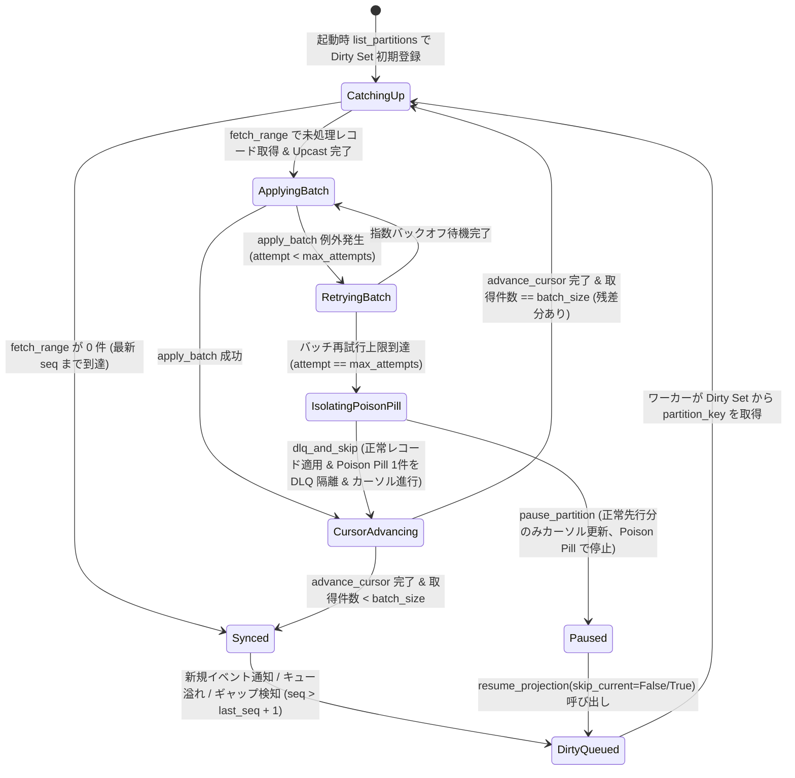
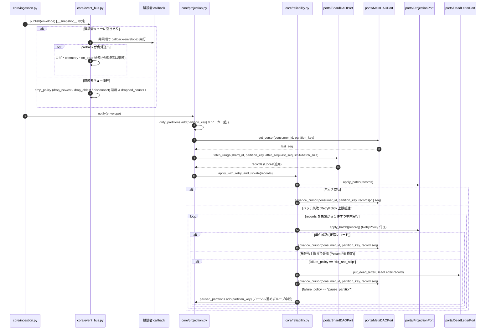

# 詳細設計書（機能・モジュール制御仕様）
**storage_kernel 配信とProjection（`core/event_bus.py`・`core/projection.py`・`core/reliability.py`）制御仕様（文書番号: DBF-DD-002）**

---

## 1. 概要とSSOT境界

### 1.1 モジュールの目的

本モジュール群（`core/event_bus.py` の `EventDispatcher`、`core/projection.py` の `ProjectionRunner`、`core/reliability.py` の `DeadLetterCoordinator`）は、書き込み確定（Write-Before-ACK）後のレコードを2つの独立した配信レーンへ非同期に届ける責務を担う（[`ADR-003`](../adr/ADR-003_配信保証の2レーン分離とSource_of_Truth方針.md)）。

1. **通知レーン（`EventDispatcher` / `subscribe`）**: 購読者ごとに独立した有界キューとディスパッチ制御を持ち、At-Most-Once で低遅延通知を行う。キュー満杯時は `drop_policy`（`drop_newest` / `drop_oldest` / `disconnect`）に従って処理し、遅い購読者やコールバック例外が他の購読者・Projection・書き込みスレッドを一切阻害しないようにする。また `__snapshot__` レコードは配信しない。
2. **投影レーン（`ProjectionRunner` & `DeadLetterCoordinator` / `register_projection`, `resume_projection`）**: シャードDBと `MetaDAOPort` のカーソルを Source of Truth とし、At-Least-Once で `ProjectionPort.apply_batch` を実行する。インメモリ通知の取りこぼしやキュー溢れは Dirty Set に記録し、起動時・定期ポーリング時・ギャップ検知時（`event.seq > last_seq + 1`）に `ShardDAOPort.fetch_range`（および読み取り時 Upcast）で自動的に追いつく。失敗時は `RetryPolicy` で再試行し、上限超過時はバッチを1件ずつ再実行して原因レコード（Poison Pill）を特定した上で、`dlq_and_skip`（DLQ隔離＋カーソル進行）または `pause_partition`（該当パーティションの投影一時停止）を実行する。

### 1.2 単一責任範囲 (SSOT) とデータ境界

- **本書の正本範囲**: `module_behavior`。配信・投影モジュール群（`core/event_bus.py`, `core/projection.py`, `core/reliability.py`）の制御フロー、内部 DTO、状態遷移、エラー・Poison Pill 処理、および機能テスト要件（`TR-DD2-001`〜`006`）の正本とする。
- **データ境界 (DTO vs DAO)**: 本書は購読スロット、Dirty Set、投影ワーカー状態などのインメモリ DTO を管理する。永続化されるカーソル（`CONSUMER_CURSOR`）および Dead Letter（`DEAD_LETTER`）の論理スキーマはデータ構造仕様書（[`DBF-DS-001`](./DBF-DS-001_データ構造仕様書.md)）を参照する。
- **BDとの関係**: システム全体のアーキテクチャ方針は基本設計書（[`DBF-BD-001`](./DBF-BD-001_基本設計書.md)）を正本とし、本書はコンポーネント `C-004` を具体化する。
- **他文書との関係**: 要求、環境、運用、テスト、ADR、レビュー文書はそれぞれの `ssot_scope` を正本とし、本書の制御仕様を上書きしない。
- **他文書へ委譲する情報**: 品質ゲートは環境・開発基盤仕様書（[`DBF-ENV-001`](../setup/DBF-ENV-001_環境・開発基盤仕様書.md)）、テストケース・実行結果・証跡はテスト計画・結果報告書を正本とし、本書へ再掲しない。
- **外部公開契約**: 公開 API（`subscribe`, `register_projection`, `resume_projection`）および Port（`ProjectionPort`, `DeadLetterPort`）の外部契約は IF/API仕様書（[`DBF-IF-001`](./DBF-IF-001_IF仕様書.md)）を正本とし、2.1 節にて IF-ID（`IF-003`〜`IF-005`, `IF-104`, `IF-105`）と対応付ける。
- **責務の対象外**: `fetch_range` で読み取った旧版レコードの Upcast 変換ロジック自体は `DBF-DD-003`（`core/sync_engine.py`）、メンテナンス時・`close()` 時のドレイン協調指示は `DBF-DD-004` へ委譲する。
- **矛盾時の扱い**: 文書の更新日ではなく、該当する `ssot_scope` の正本を更新し、関連文書を追従させる。

---

## 2. インターフェースと DTO (Data Transfer Object) 仕様

### 2.1 対象機能一覧

| 機能ID | 関数・機能名 | 呼び出し元 | 主な呼び出し先 | 同期 / 非同期 | 冪等性 | 外部副作用 | 公開範囲 |
| :--- | :--- | :--- | :--- | :---: | :---: | :--- | :---: |
| F-201 | `StorageKernel.subscribe` / `EventDispatcher.register_subscriber` | 親プロジェクト購読モジュール | `F-204`, 購読者別ワーカースレッド起動 | 同期（配信は非同期） | なし（新規ハンドル生成） | インメモリ購読スロット作成 | 外部公開（`IF-003`） |
| F-202 | `StorageKernel.register_projection` / `ProjectionRunner.start` | 親プロジェクト Composition Root | `F-204`, `F-206`, `ProjectionRunner` ワーカースレッド起動 | 同期（投影は非同期） | なし（同一 `consumer_id` 重複不可） | バックグラウンド投影ワーカー起動 | 外部公開（`IF-004`） |
| F-203 | `StorageKernel.resume_projection` / `ProjectionRunner.resume_partition` | 親プロジェクト運用・管理機能 | `MetaDAOPort.get_cursor`, `MetaDAOPort.advance_cursor`, Dirty Set 登録 | 同期 | 条件付き（稼働中かつ `skip_current=False` 時） | `skip_current=True` 時はカーソルを `+1` 更新し `PAUSED` 解除 | 外部公開（`IF-005`） |
| F-204 | `PatternMatcher.compile_and_match` | `F-201`, `F-202`, `F-205`, `F-206` | 文字列前方一致・完全一致判定 | 同期 | あり（純粋関数） | なし | 内部 |
| F-205 | `EventDispatcher.publish` & 購読者ワーカー配信 | `WritePipeline` (`DBF-DD-001` `F-101`) | `F-204`, 購読者別有界キュー, 購読者 `callback`, `on_error` | 非同期（投入はノンブロッキング） | なし（At-Most-Once） | 購読者コールバック呼び出し、`dropped_count` 更新 | 内部 |
| F-206 | `ProjectionRunner.notify_and_catchup_loop` | `WritePipeline` (`F-101`, `F-102`) / 起動時・定期タイマー | `MetaDAOPort.list_partitions`, `MetaDAOPort.get_cursor`, `ShardDAOPort.fetch_range`, `DBF-DD-003` (`F-302` Upcast), `F-207`, `MetaDAOPort.advance_cursor` | 非同期 | あり（`apply_batch` の冪等契約と単調カーソルによる） | `ProjectionPort.apply_batch`, `MetaDAOPort.advance_cursor` | 内部 |
| F-207 | `DeadLetterCoordinator.apply_with_retry_and_isolate` | `F-206` | `ProjectionPort.apply_batch`, `DeadLetterPort.put_dead_letter`, `MetaDAOPort.advance_cursor` | 同期（ワーカー内） | あり | 指数バックオフ待機、Poison Pill 単件特定、DLQ 保存またはパーティション一時停止 | 内部 |

### 2.2 主要関数・機能の契約

#### 機能契約（機能ID: F-201 `subscribe` & F-205 `EventDispatcher.publish`）

- **対象機能・関数名**: `StorageKernel.subscribe` / `EventDispatcher.register_subscriber` / `EventDispatcher.publish`
- **機能概要**:
  - `register_subscriber`: パターン文法（`F-204`）を検証し、容量 `max_queue_size`（既定 256）の購読者専用有界キュー（`collections.deque` + `threading.Condition`）と配信ワーカースレッドを生成して `SubscriptionHandle` を返す。
  - `publish`: `record.record_type == "__snapshot__"` の場合は即座に無視する（スナップショット非配信）。それ以外はパターンが一致する全アクティブ購読者のキューへノンブロッキングで投入する。キューが満杯（`len == max_queue_size`）の場合は `drop_policy` に従って以下のとおり処理する：
    - `"drop_newest"`: 今回の新規イベントを破棄し、`dropped_count` を `+1` する。
    - `"drop_oldest"`: キュー先頭の最古イベントを1件取り出して破棄し、新規イベントを末尾へ追加して `dropped_count` を `+1` する。
    - `"disconnect"`: 新規イベントを破棄して `dropped_count` を `+1` し、`is_active = False` に遷移させて購読を自動解除（キュー閉鎖）する。
  - 購読者ワーカーはキューからイベントを取り出して `callback(envelope)` を実行する。`callback` が例外を送出した場合は握りつぶさず、エラーログ・telemetry に記録し、`on_error(envelope, exc)` が指定されていれば呼び出した上で、次のイベント処理を継続する。
- **事前条件 (Pre-conditions)**: `pattern` が有効な3パターンのいずれかであり、`max_queue_size >= 1` であること。
- **事後条件 (Post-conditions)**: 書き込みスレッドや他購読者・Projection を一切ブロックせずにイベントが投入・配信される。
- **タイムアウト / キャンセル**: `SubscriptionHandle.unsubscribe()` または `close()` 呼び出し時に `is_active = False` となりワーカーが終了する。
- **ログ・メトリクス・相関ID**: `subscription_id`, `pattern`, `dropped_count`, コールバック例外型を telemetry に記録する。
- **外部公開時の互換性・認証**: [`DBF-IF-001`](./DBF-IF-001_IF仕様書.md) 4.3節（`IF-003`）を参照。

#### 機能契約（機能ID: F-202 `register_projection` & F-206 `ProjectionRunner.notify_and_catchup_loop`）

- **対象機能・関数名**: `StorageKernel.register_projection` / `ProjectionRunner.notify_and_catchup_loop`
- **機能概要**:
  - 登録時に `ProjectionPort.consumer_id` の一意性と `failure_policy`（省略時は `DeadLetterPort` の有無で `"dlq_and_skip"` または `"pause_partition"` に決定）を検証し、Projection 専用の `ProjectionRunner` ワーカーを起動する。
  - **起動時キャッチアップ**: `MetaDAOPort.list_partitions()` で全登録済みパーティションを取得し、`partition_patterns` に一致するすべての `partition_key` を Dirty Set に初期投入する。
  - **Fast Path 通知と Dirty Set**: 書き込み完了時に `notify(envelope)` が呼ばれる。対象パターンに一致しない場合、または `include_snapshots=False` かつ `record_type == "__snapshot__"`（ただしカーソル進行対象としてギャップを作らないよう Dirty Set 経由またはスキップ処理）の場合は適切にフィルタする。インメモリ通知キューが満杯の場合、または受け取った `envelope.seq > current_cursor + 1`（ギャップ検知）の場合は、イベントを黙って捨てずに該当 `partition_key` を Dirty Set（`set[str]`）へ追加する。
  - **Catch-up 実行**: Dirty Set から `partition_key`（一時停止中 `paused_partitions` に含まれるものを除く）を取り出し、`last_seq = MetaDAOPort.get_cursor(consumer_id, partition_key)` を取得し、`ShardDAOPort.fetch_range(shard_id, partition_key, after_seq=last_seq, limit=batch_size)` で未処理レコード群を取得する。取得した各レコードに読み取り時 Upcast（`DBF-DD-003` `F-302`）を適用する。`include_snapshots=False` の場合はバッチから `__snapshot__` レコードを除いたスライスを `F-207`（`apply_batch`）へ渡し、バッチ全体の最終 `seq` まで `MetaDAOPort.advance_cursor` を進める（メンテナンスモード中は待機または中断する）。まだ `len(fetched) == batch_size` であれば再度 Dirty Set に戻して追いつきを継続する。
- **事前条件 (Pre-conditions)**: `ProjectionPort.apply_batch` が `(partition_key, seq)` に対して冪等であること。
- **事後条件 (Post-conditions)**: `apply_batch` が正常完了した後にのみ `advance_cursor` が呼ばれ、Event Bus のキュー溢れや再起動があっても最終的に全レコードが欠落なく投影される。
- **タイムアウト / キャンセル**: `close()` または `enter_maintenance()` 呼び出し時に新規バッチ取得を停止する。
- **ログ・メトリクス・相関ID**: `consumer_id`, `partition_key`, `last_seq`, バッチ件数, Dirty Set サイズを telemetry に記録する。
- **外部公開時の互換性・認証**: [`DBF-IF-001`](./DBF-IF-001_IF仕様書.md) 4.4節（`IF-004`）を参照。

#### 機能契約（機能ID: F-207 `DeadLetterCoordinator.apply_with_retry_and_isolate` & F-203 `resume_projection`）

- **対象機能・関数名**: `DeadLetterCoordinator.apply_with_retry_and_isolate` / `StorageKernel.resume_projection`
- **機能概要**:
  1. **バッチ適用と指数バックオフ再試行**: `records` バッチに対して `ProjectionPort.apply_batch(records)` を呼び出す。例外発生時は `advance_cursor` を呼ばず、`RetryPolicy` に従って `delay = min(max_delay_sec, initial_delay_sec * (backoff_multiplier ** (attempt - 1)))` 秒待機しながら最大 `max_attempts` 回まで再試行する。
  2. **Poison Pill の単件特定（Bisection / Single-step Isolation）**: バッチが `max_attempts` 回とも失敗した場合、バッチ内の正常レコードを巻き込まないよう、`records` を先頭から **1件ずつ** `[record]` の単件バッチとして `RetryPolicy` 付きで順に適用する。
     - 単件適用が成功した正常レコードは、その都度 `MetaDAOPort.advance_cursor(consumer_id, partition_key, record.seq)` でカーソルを確定させる。
     - 単件適用でも `max_attempts` 回失敗したレコードを真の原因レコード（Poison Pill）として特定する。
  3. **`failure_policy` の適用**:
     - `"dlq_and_skip"`: `DeadLetterPort.put_dead_letter(DeadLetterRecord(...))` を呼び出して原因レコード1件を永続化隔離し、`MetaDAOPort.advance_cursor(consumer_id, partition_key, poison_record.seq)` でカーソルを進めてから、同じバッチの残りレコードの単件適用を最後まで継続する。
     - `"pause_partition"`: カーソルを進めず（原因レコードの直前の `seq` で止めたまま）、該当 `partition_key` を `paused_partitions` に追加してエラーイベント・ログを出力し、当該パーティションの投影ループを停止する（他のパーティションの投影は継続する）。
  4. **再開（`F-203` `resume_projection`）**: 指定 `(consumer_id, partition_key)` が `paused_partitions` にあるとき、`skip_current=True` が指定されていれば停止原因となっていた先頭未処理レコード1件（`current_cursor + 1`、または `fetch_range(..., limit=1)` の先頭 `seq`）まで `MetaDAOPort.advance_cursor` でカーソルを進める。その後 `paused_partitions` から当該 `partition_key` を除去し、Dirty Set に再追加してワーカーを起床させる。
- **事前条件 (Pre-conditions)**: `"dlq_and_skip"` 選択時は `DeadLetterPort` が注入されていること。
- **事後条件 (Post-conditions)**: `"dlq_and_skip"` では Poison Pill 1件のみが DLQ に格納されて残りの正常レコードはすべて適用される。`"pause_partition"` では原因レコードでカーソルが停止し、`resume_projection` でいつでも再開できる。
- **タイムアウト / キャンセル**: 再試行待機中に `close()` が呼ばれた場合は即座に待機を中断し、カーソルを進めずに終了する（次回起動時に再処理される）。
- **ログ・メトリクス・相関ID**: `consumer_id`, `partition_key`, `seq`, `attempts`, `error_type`, `failure_policy` 処置結果を記録する。
- **外部公開時の互換性・認証**: [`DBF-IF-001`](./DBF-IF-001_IF仕様書.md) 4.4節（`IF-004`, `IF-005`）を参照。

#### 機能契約（機能ID: F-204 `PatternMatcher.compile_and_match`）

- **対象機能・関数名**: `PatternMatcher.compile_and_match`
- **機能概要**: パターン文字列を検査・コンパイルし、`partition_key` との一致を判定する。
  - `"*"`: 任意の `partition_key` に一致する。
  - 末尾のみが `"*"`（例: `"chat:*"`、`pattern[:-1]` に `"*"` を含まない非空文字列）: `partition_key.startswith(pattern[:-1])` で前方一致判定する。
  - `"*"` を一切含まない非空文字列（例: `"chat:general"`）: `partition_key == pattern` で完全一致判定する。
  - 上記以外（空文字列、先頭・途中の `"*"`、複数の `"*"`、正規表現記号による曖昧指定）は `ValueError` を送出する（Issue #3 C2）。
- **事前条件 / 事後条件**: 純粋関数として O(1)〜O(プレフィックス長) で判定する。

### 2.3 入力 DTO スキーマ・パラメータ仕様

公開 API（`F-201`〜`F-203`）の入力引数は [`DBF-IF-001`](./DBF-IF-001_IF仕様書.md) 4.3〜4.4節を正本とする。ここでは内部で管理する購読スロットおよび Projection ランナー状態の DTO を定義する。

- **対象機能ID**: `F-201`, `F-205`（内部 DTO `SubscriberSlot[T]`）および `F-202`, `F-206`, `F-207`（内部 DTO `ProjectionWorkerState[T]`）

| DTO名 / フィールド | データ型 | 必須性 | NULL可 | デフォルト値 | バリデーションルール・入力制約 | 例・備考 |
| :--- | :--- | :---: | :---: | :--- | :--- | :--- |
| `SubscriberSlot.subscription_id` | `str` | 必須 | 不可 | なし | 一意な識別子 | `"sub-0001"` |
| `SubscriberSlot.pattern` | `str` | 必須 | 不可 | なし | `F-204` で検証済みのパターン | `"order:*"` |
| `SubscriberSlot.queue` | `deque[RecordEnvelope[T]]` | 必須 | 不可 | 空 deque | 最大要素数 `max_queue_size`（`>= 1`） | 有界リングバッファ |
| `SubscriberSlot.drop_policy` | `DropPolicy` | 必須 | 不可 | `"drop_newest"` | `"drop_newest"` / `"drop_oldest"` / `"disconnect"` | - |
| `SubscriberSlot.dropped_count` | `int` | 必須 | 不可 | `0` | `>= 0`（ドロップ発生ごとに単調増加） | `SubscriptionHandle.dropped_count` で公開 |
| `SubscriberSlot.is_active` | `bool` | 必須 | 不可 | `True` | `unsubscribe()` または `disconnect` で `False` | - |
| `ProjectionWorkerState.consumer_id` | `str` | 必須 | 不可 | なし | `projection.consumer_id`（カーネル内で一意） | `"fts_projection"` |
| `ProjectionWorkerState.partition_patterns` | `tuple[str, ...]` | 必須 | 不可 | `("*",)` | 各要素が `F-204` 検証済み | `("chat:*",)` |
| `ProjectionWorkerState.batch_size` | `int` | 必須 | 不可 | `100` | `>= 1` | `fetch_range` の `limit` に使用 |
| `ProjectionWorkerState.retry_policy` | `RetryPolicy` | 必須 | 不可 | `RetryPolicy()` | `max_attempts >= 1` | - |
| `ProjectionWorkerState.failure_policy` | `ProjectionFailurePolicy` | 必須 | 不可 | 自動解決 | `"dlq_and_skip"` または `"pause_partition"` | - |
| `ProjectionWorkerState.include_snapshots` | `bool` | 必須 | 不可 | `False` | `True` のときのみ `__snapshot__` を `apply_batch` に渡す | - |
| `ProjectionWorkerState.dirty_partitions` | `set[str]` | 必須 | 不可 | 空集合 | 追いつきが必要な `partition_key` の集合（ロック保護） | Dirty Set |
| `ProjectionWorkerState.paused_partitions` | `set[str]` | 必須 | 不可 | 空集合 | `pause_partition` により一時停止中の `partition_key` 集合 | `resume_projection` で解除 |

### 2.4 出力 DTO スキーマ・戻り値仕様

- **対象機能ID**: `F-201`（戻り値 `SubscriptionHandle`、[`DBF-IF-001`](./DBF-IF-001_IF仕様書.md) 2.3節参照）、`F-207`（DLQ 出力 DTO `DeadLetterRecord[T]`、[`DBF-IF-001`](./DBF-IF-001_IF仕様書.md) 2.3節参照）。
- **異常時の戻り値 / 例外**:
  - 登録・再開呼び出し時：`ValueError`, `KernelClosedError`, `KernelMaintenanceError`。
  - 非同期ワーカー実行中：例外は呼び出し元スレッドへは伝搬せず、`subscribe` では `on_error` とログ/telemetry、`ProjectionRunner` では `RetryPolicy` → `DeadLetterPort.put_dead_letter` または `pause_partition` 遷移として処理される。
- **再試行可否**: `ProjectionRunner` が `RetryPolicy` に従って自動再試行する。`pause_partition` 到達後は運用者が原因解消後に `resume_projection` を呼び出す。
- **相関ID・監査情報**: `subscription_id`、`consumer_id`、および `(partition_key, seq)`。

---

## 3. 処理フロー・シーケンス・状態遷移ロジック (Mermaid 図)

### 3.1 処理フロー・シーケンス / 状態遷移図

- **図の正本**: 状態遷移表（3.2節）および下記の状態遷移図・シーケンス図を併用して正本とする。
- **対象機能ID**: `F-201`〜`F-207`

#### A. ProjectionRunner のパーティション別状態遷移図 (State Diagram)

#### B. 2レーン配信・Dirty Set 追いつき・Poison Pill 隔離のシーケンス図 (Sequence Diagram)

### 3.2 状態遷移およびルーティングルール

- **初期状態**:
  - `SubscriberSlot`: `Active`（登録直後、`is_active=True`, `dropped_count=0`）。
  - `ProjectionRunner`（パーティション単位）: `CatchingUp`（起動時の全パーティション走査により Dirty Set に積まれた状態）。
- **終端状態**:
  - `SubscriberSlot`: `Disconnected`（`unsubscribe()` 呼び出し、`drop_policy="disconnect"` 発動、またはカーネル `close()` 完了）。
  - `ProjectionRunner`: カーネル `close()` による `Stopped` 状態（`Paused` は運用者の `resume_projection` で復帰可能な待機状態）。
- **状態不変条件**:
  - `MetaDAOPort.advance_cursor` は、`apply_batch` が成功したレコード、または `dlq_and_skip` で `DeadLetterPort.put_dead_letter` が成功したレコード、または `resume_projection(skip_current=True)` が明示されたレコードに対してのみ呼び出される。
  - `paused_partitions` に含まれる `partition_key` は、`resume_projection` が呼ばれるまで `fetch_range` および `apply_batch` の実行対象から除外される（その間も他のパーティションの投影は止まらない）。
- **未定義イベントの扱い**: `DeadLetterPort.put_dead_letter` 自体が例外を送出した場合は、データの無断消失を防ぐためカーソルを進めず、自動的に `pause_partition` と同じ状態へフォールバックしてエラーログを出力する。

| 現在の状態 / ノード | 実行結果 / 評価フラグ | 次の状態 / ノード | 遷移判定条件・閾値ルール | 副作用・ログ / メトリクス |
| :--- | :--- | :--- | :--- | :--- |
| `Subscriber: Active` | キュー空きあり | `Subscriber: Active` | `len(queue) < max_queue_size` | イベントを末尾へ追加しワーカーへ通知 |
| `Subscriber: Active` | キュー満杯 (`drop_newest`) | `Subscriber: Active` | `len(queue) == max_queue_size` かつ `drop_policy == "drop_newest"` | 新規イベントを破棄、`dropped_count += 1`、警告 telemetry |
| `Subscriber: Active` | キュー満杯 (`drop_oldest`) | `Subscriber: Active` | `len(queue) == max_queue_size` かつ `drop_policy == "drop_oldest"` | `queue.popleft()` で最古を破棄し新規を追加、`dropped_count += 1` |
| `Subscriber: Active` | キュー満杯 (`disconnect`) | `Subscriber: Disconnected` | `len(queue) == max_queue_size` かつ `drop_policy == "disconnect"` | 新規を破棄、`dropped_count += 1`、`is_active = False` に遷移 |
| `Projection: Synced` | 書き込み通知 / 溢れ | `Projection: DirtyQueued` | パターン一致の書き込み発生（` paused_partitions` 外） | `dirty_partitions.add(partition_key)` |
| `Projection: CatchingUp` | 未処理レコードあり | `Projection: ApplyingBatch` | `fetch_range(after_seq=last_seq)` が1件以上返却 | Upcast を適用し、`include_snapshots=False` なら `__snapshot__` をフィルタ |
| `Projection: ApplyingBatch` | `apply_batch` 成功 | `Projection: CursorAdvancing` | 例外なしで `apply_batch` が復帰 | `advance_cursor(consumer_id, partition_key, batch_last_seq)` を実行 |
| `Projection: ApplyingBatch` | `apply_batch` 例外（リトライ内） | `Projection: RetryingBatch` | `attempt < retry_policy.max_attempts` | カーソルを更新せず指数バックオフ待機後に再実行 |
| `Projection: RetryingBatch` | バッチリトライ上限到達 | `Projection: IsolatingPoisonPill` | `attempt == retry_policy.max_attempts` | バッチを1件ずつ単件リトライ実行へ切り替え |
| `Projection: IsolatingPoisonPill` | Poison Pill 特定 (`dlq_and_skip`) | `Projection: CursorAdvancing` | 単件も上限失敗 かつ `failure_policy == "dlq_and_skip"` | `put_dead_letter` に保存し当該 `seq` まで `advance_cursor`、残りの単件処理を継続 |
| `Projection: IsolatingPoisonPill` | Poison Pill 特定 (`pause_partition`) | `Projection: Paused` | 単件も上限失敗 かつ `failure_policy == "pause_partition"` | 当該 `seq` の手前でカーソルを止め、`paused_partitions.add(partition_key)` |
| `Projection: Paused` | `resume_projection` 呼び出し | `Projection: DirtyQueued` | `skip_current=True` なら原因レコード1件の `seq` まで `advance_cursor` | `paused_partitions.discard(partition_key)` し `dirty_partitions.add(partition_key)` |

---

## 4. エラー処理・失敗契約

### 4.1 エラー分類と対処方針

| エラーコード / 例外型 | エラーカテゴリ | 発生・判定基準 | 再試行上限 | 再試行安全条件 | 終端ステータス | 利用者・運用者対応 | 副作用・データ保持契約 |
| :--- | :--- | :--- | :---: | :--- | :--- | :--- | :--- |
| 購読者 `callback` 内の任意例外 | 購読者処理エラー | `subscribe` のコールバック実行中に例外送出 | 0回（At-Most-Once） | なし（再試行しない） | 継続（`Active` 維持） | `on_error` ハンドラまたはログで例外原因を修正する | 他の購読者・Projection は一切止まらず、次のイベント処理へ進む |
| `ProjectionPort.apply_batch` の一時的エラー | 投影一時障害 | DBロック競合等で `apply_batch` が失敗 | `RetryPolicy.max_attempts`（既定3回） | `apply_batch` が `(partition_key, seq)` で冪等であること | 自動回復（`CursorAdvancing`） | 自動回復するため対応不要 | 失敗中は `advance_cursor` が呼ばれず、再試行で全件適用される |
| `ProjectionPort.apply_batch` の恒久的エラー（Poison Pill） | 投影データ不整合 / バグ | バッチ再試行上限超過後、単件再実行でも `max_attempts` 回失敗 | バッチ N回 ＋ 単件 N回 | 単件ごとに直前の正常レコードまではカーソル確定済み | `dlq_and_skip`: DLQ隔離して継続 / `pause_partition`: `Paused` | `list_dead_letters` で原因を確認するか、修正後に `resume_projection(skip_current=...)` を呼ぶ | 同じバッチ内の正常レコードは確実に適用され、Poison Pill 1件のみが隔離または停止対象となる |
| `SchemaVersionError`（投影読み取り時） | スキーマ移行エラー | `fetch_range` 後の Upcast で未知の版または変換経路欠落 | 0回（リトライ不可の恒久エラー） | `PayloadUpcaster` を修正して再起動または `resume_projection` | `Paused`（データ保護のため DLQ スキップせず当該パーティションを一時停止） | `PayloadUpcaster` または `schema_registry` を修正する | カーソルを進めず停止するため、Upcaster 修正後に欠落なく投影を再開できる |
| `ValueError`（登録・再開引数不正） | 入力契約違反 | 不正な購読パターン、重複/未登録 `consumer_id`、DLQ なしでの `dlq_and_skip` 指定 | 0回（不可） | なし | 呼び出し拒否 | 引数または DI 構成を修正する | 既存の購読者・Projection 状態は変更されない |

---

## 5. 機能テスト要件

機能が保証すべき振る舞いを要件として定義する（Issue #2・#3・#4 の基盤ユニットテスト項目に対応）。具体的なテストケース・実行結果・証跡はテスト計画・結果報告書、品質ゲートは [`DBF-ENV-001`](../setup/DBF-ENV-001_環境・開発基盤仕様書.md) を正本とし、本書へ再掲しない。

### 5.1 機能テスト要件一覧

| 要件ID | 対象機能ID | 保証すべき振る舞い・条件 | 検証観点 | 対応テストケース |
| :--- | :--- | :--- | :--- | :--- |
| TR-DD2-001 | F-202 / F-206 | **Event Bus 取りこぼし・キュー溢れからの自動追いつき**: インメモリ通知のドロップやキュー溢れが発生しても、Dirty Set と `fetch_range` 経由で `ProjectionRunner` が自動的に全レコードへ追いつくこと（Issue #2） | 正常 / 異常回復 / 信頼性 | `tests/unit/test_projection.py::test_projection_catches_up_via_dirty_set_on_queue_overflow` |
| TR-DD2-002 | F-206 / F-207 | **`apply_batch` 例外時のカーソル保護と再試行**: `apply_batch` が例外を送出したとき `advance_cursor` が決して呼ばれず、`RetryPolicy` に基づく再試行で再処理されてからカーソルが進むこと（Issue #2） | 異常 / 再試行 / 冪等性 | `tests/unit/test_projection.py::test_cursor_not_advanced_on_apply_batch_failure_and_retried` |
| TR-DD2-003 | F-201 / F-205 | **Slow Consumer の隔離と `drop_policy` カウント**: `subscribe` の特定の購読者が遅延または例外を送出しても、他の購読者および Projection が止まらないこと。また `drop_policy`（`drop_newest` / `drop_oldest` / `disconnect`）ごとのドロップ件数が `SubscriptionHandle.dropped_count` に正確に出ること（Issue #3） | 正常 / 並行性 / 背圧制御 | `tests/unit/test_event_bus.py::test_slow_subscriber_isolation_and_drop_policies` |
| TR-DD2-004 | F-203 / F-207 | **Poison Pill の単件隔離と一時停止からの再開**: バッチ内に1件の Poison Pill があるとき、`dlq_and_skip` ではその1件だけが `DeadLetterPort` に隔離されて同じバッチの正常なレコードはすべて適用されること。また `pause_partition` で停止したパーティションが `resume_projection(skip_current=False/True)` で再開できること（Issue #3） | 異常 / 隔離 / 運用回復 | `tests/unit/test_projection.py::test_poison_pill_single_record_isolation_and_resume` |
| TR-DD2-005 | F-201 / F-202 / F-205 / F-206 | **`__snapshot__` の配信フィルタリング**: `record_type="__snapshot__"` のレコードが通常の `subscribe` と既定（`include_snapshots=False`）の Projection には届かず、`include_snapshots=True` を指定した Projection にだけ届くこと（Issue #4） | 正常 / フィルタ | `tests/unit/test_projection.py::test_snapshot_filtering_for_subscribers_and_projections` |
| TR-DD2-006 | F-204 | **購読パターン3種の照合と不正パターンの拒否**: 完全一致、`*`、末尾ワイルドカード（`chat:*`）が正しく照合され、途中の `*` などの不正パターンが `ValueError` で拒否されること（Issue #3） | 正常 / 境界 / 異常 | `tests/unit/test_event_bus.py::test_subscription_pattern_matching_and_validation` |

### 5.2 適用する品質ゲート

- **品質ゲートの正本**: [`DBF-ENV-001 環境・開発基盤仕様書`](../setup/DBF-ENV-001_環境・開発基盤仕様書.md)（4.4節）
- **適用するゲートID**: 全件（`QG-001`〜`QG-006`）
- 本機能だけに必要な条件がある場合は、環境・開発基盤仕様書へゲートを追加してから参照する。本書には実行コマンドや合格基準を記載しない。

---

## 6. 作成完了チェック

- [x] `document_role`、`ssot_scope`、`status`、`owner`をFrontmatterへ設定した。
- [x] 対象機能一覧のIDと、契約・DTO・状態遷移・機能テスト要件のIDが対応している。
- [x] 呼び出し元・呼び出し先、同期方式、冪等性、外部副作用、公開範囲を記入した。
- [x] 外部公開する機能は、IF/API仕様書を参照するか、機能契約に互換性・認証方針を記入した。
- [x] 事前条件、事後条件、タイムアウト、キャンセル、ログ・相関IDを記入した。
- [x] 入力・出力DTOの必須性、NULL可否、制約、異常時形式を記入した。
- [x] 初期状態、終端状態、未定義イベント、状態不変条件を記入した。
- [x] エラーコード/例外型、再試行安全条件、利用者・運用者対応、データ保持契約を記入した。
- [x] 機能テスト要件ごとに検証観点と、テスト計画・結果報告書の対応ケースIDを記入した。
- [x] 品質ゲートは環境・開発基盤仕様書のゲートIDを参照し、実行コマンド・合格基準・テストケースを本書へ再掲していない。
- [x] Mermaidのサンプル状態名・エラー名・閾値および未置換の `[ ... ]` が残っていない。

---

## 7. 改訂履歴 (Change Log)

| 版数    | 改訂日     | 変更者 | 変更内容・変更理由 (Why)                                              |
| :------ | :--------- | :----- | :-------------------------------------------------------------------- |
| Rev.1.0 | 2026-11-19 | xzyozi | 新規作成（Issue #15 に基づき配信とProjection core/event_bus, projection, reliability の詳細設計を制定） |
