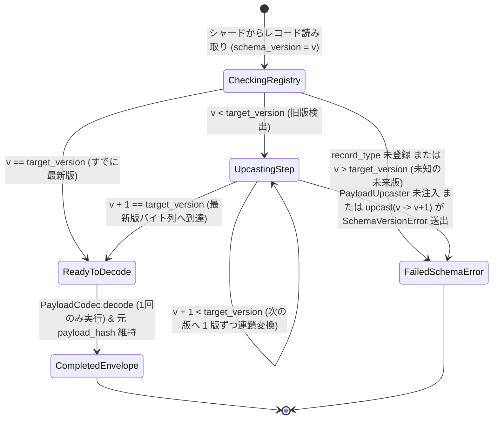
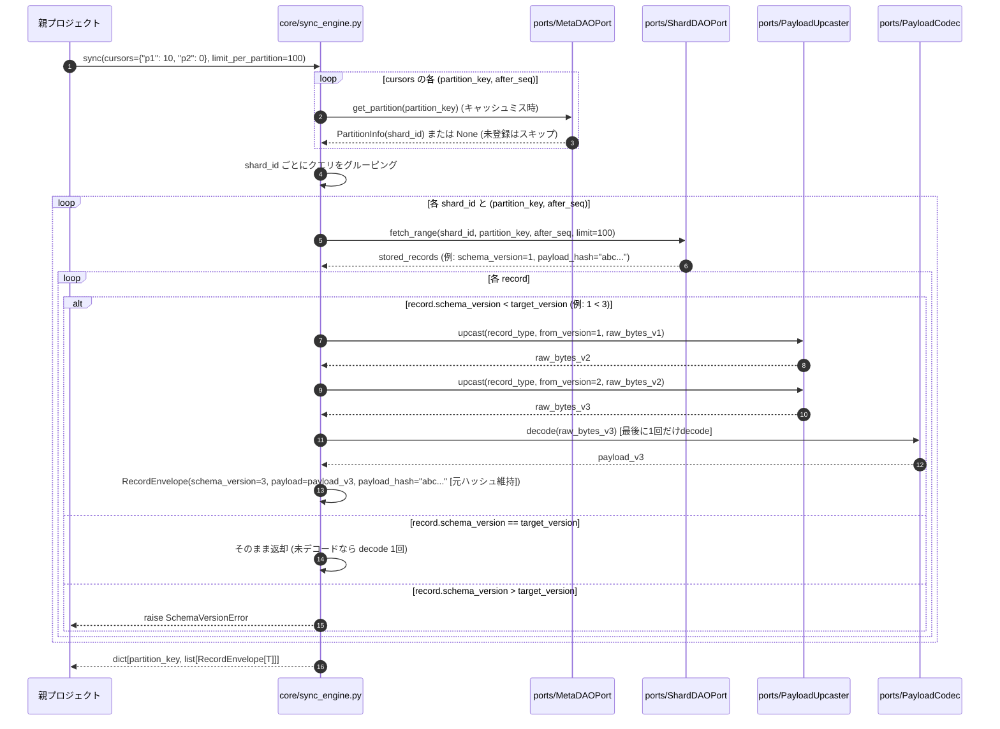

# 詳細設計書（機能・モジュール制御仕様）
**storage_kernel 同期と版管理（`core/sync_engine.py`）制御仕様（文書番号: DBF-DD-003）**

---

## 1. 概要とSSOT境界

### 1.1 モジュールの目的

本モジュール（`core/sync_engine.py` の `CursorSyncEngine` および `UpcastPipeline`）は、以下の2つの責務を担う（Issue #4 D1・D3、[`ADR-005`](../adr/ADR-005_v1スコープの限定と将来拡張に向けた前方互換契約の先行定義.md)）：

1. **複数シャード横断のカーソル差分取得（Scatter-Gather Sync）**: クライアントやモジュールが保持する `{partition_key: last_seen_seq}` を受け取り、ルーティングキャッシュおよび `MetaDAOPort.get_partition` から各パーティションの所属 `shard_id` を解決（未登録パーティションは新規バインドせずスキップ）し、シャードごとにグルーピングして `ShardDAOPort.fetch_range` で未処理レコード群を取得する。
2. **読み取り時のバイト列 Upcast と版管理**: `sync` および `ProjectionRunner`（`DBF-DD-002`）がシャードからレコードを読み取る際、レコードの `schema_version` が `KernelConfig.schema_registry[record_type]` の最新版より古い場合は、`PayloadUpcaster.upcast` を用いてデコード前のバイト列（`bytes`）を **1版ずつ**（例: `v1 -> v2 -> v3`）最新版まで変換し、最後に1回だけ `PayloadCodec.decode` を適用する。このとき、ストレージ上の保存済みレコードは一切書き換えず、`RecordEnvelope.payload_hash` も保存時の元データの値をそのまま維持する。

### 1.2 単一責任範囲 (SSOT) とデータ境界

- **本書の正本範囲**: `module_behavior`。同期・版管理モジュール（`core/sync_engine.py`）の制御フロー、内部 DTO、状態遷移、エラー処理、および機能テスト要件（`TR-DD3-001`〜`004`）の正本とする。
- **データ境界 (DTO vs DAO)**: 本書は Scatter-Gather グルーピング要求や Upcast 変換中の内部 DTO を管理する。永続化されているレコード構造と不変条件（`INV-DS-007`）はデータ構造仕様書（[`DBF-DS-001`](./DBF-DS-001_データ構造仕様書.md)）を参照する。
- **BDとの関係**: システム全体のアーキテクチャ方針は基本設計書（[`DBF-BD-001`](./DBF-BD-001_基本設計書.md)）を正本とし、本書はコンポーネント `C-005` を具体化する。
- **他文書との関係**: 要求、環境、運用、テスト、ADR、レビュー文書はそれぞれの `ssot_scope` を正本とし、本書の制御仕様を上書きしない。
- **他文書へ委譲する情報**: 品質ゲートは環境・開発基盤仕様書（[`DBF-ENV-001`](../setup/DBF-ENV-001_環境・開発基盤仕様書.md)）、テストケース・実行結果・証跡はテスト計画・結果報告書を正本とし、本書へ再掲しない。
- **外部公開契約**: 公開 API `StorageKernel.sync`（`IF-009`）および `PayloadCodec`（`IF-106`）・`PayloadUpcaster`（`IF-107`）の外部契約は IF/API仕様書（[`DBF-IF-001`](./DBF-IF-001_IF仕様書.md)）を正本とする。
- **責務の対象外**: 書き込み時の最新 `schema_version` 一致検査は `DBF-DD-001`（`F-104`）が担当する。
- **矛盾時の扱い**: 文書の更新日ではなく、該当する `ssot_scope` の正本を更新し、関連文書を追従させる。

---

## 2. インターフェースと DTO (Data Transfer Object) 仕様

### 2.1 対象機能一覧

| 機能ID | 関数・機能名                                   | 呼び出し元                                         | 主な呼び出し先                                                   | 同期 / 非同期 |            冪等性            | 外部副作用                                          |       公開範囲       |
| :----- | :--------------------------------------------- | :------------------------------------------------- | :--------------------------------------------------------------- | :-----------: | :--------------------------: | :-------------------------------------------------- | :------------------: |
| F-301  | `StorageKernel.sync` / `CursorSyncEngine.sync` | 親プロジェクト同期クライアント                     | `MetaDAOPort.get_partition`, `ShardDAOPort.fetch_range`, `F-302` |     同期      |     あり（読み取り専用）     | なし（DB上のレコード・台帳・カーソルを変更しない）  | 外部公開（`IF-009`） |
| F-302  | `UpcastPipeline.upcast_and_decode_envelope`    | `F-301`, `ProjectionRunner` (`DBF-DD-002` `F-206`) | `PayloadUpcaster.upcast`, `PayloadCodec.decode`                  |     同期      | あり（決定論的・副作用なし） | なし（メモリ上の新しい `RecordEnvelope[T]` を生成） |         内部         |

### 2.2 主要関数・機能の契約

#### 機能契約（機能ID: F-301 `StorageKernel.sync` / `CursorSyncEngine.sync`）

- **対象機能・関数名**: `StorageKernel.sync` → `CursorSyncEngine.sync`
- **機能概要**:
  1. **入力検査**: `limit_per_partition >= 1`、および `cursors` 内の各 `after_seq >= 0` を検査する（違反時は `ValueError`）。
  2. **シャード解決とグルーピング（Scatter 準備）**: 各 `partition_key` についてルーティングキャッシュまたは `MetaDAOPort.get_partition(partition_key)` を照会する。**注意**: `sync` は読み取り専用操作であるため、未登録の `partition_key` に対して `bind_shard` を呼び出して空パーティションを作成してはならず、未登録パーティションは差分 0 件としてスキップする。`status == "read_only"` のパーティションは通常どおり読み取り対象に含める（Issue #3 C5）。
  3. **シャード別差分取得と Upcast（Gather）**: `shard_id` ごとにまとまった `(partition_key, after_seq)` リストに対し、`ShardDAOPort.fetch_range(shard_id, partition_key, after_seq, limit_per_partition)` を実行する。取得した各レコードに `F-302`（Upcast）を適用し、1件以上のレコードが存在する `partition_key` のみを結果辞書 `{partition_key: list[RecordEnvelope[T]]}` に格納して返す。
  4. **期限切れカーソルの扱い**: v1 では Retention（古いログの削除）を行わないため `CursorExpiredError` は発生しないが、DAO または将来の Retention 境界検査から `CursorExpiredError` が送出された場合はそのまま呼び出し元へ透過送出し、呼び出し元が最新 `__snapshot__` から再開できるようにする（Issue #4 D1）。
- **事前条件 (Pre-conditions)**: `cursors` の各値が `0` 以上の整数であり、`limit_per_partition >= 1` であること。
- **事後条件 (Post-conditions)**: 返却されるすべてのレコードが最新の `schema_version` に変換されており、`seq` の厳密な昇順で欠落がないこと。
- **タイムアウト / キャンセル**: 同期読み取りとして DAO のクエリ完了まで実行する（メンテナンスモード中でも読み取り専用の `sync` はブロックしないか、DAO 接続に従う）。
- **ログ・メトリクス・相関ID**: 要求パーティション数、返却総レコード数、Upcast 実行件数を telemetry に記録する。
- **外部公開時の互換性・認証**: [`DBF-IF-001`](./DBF-IF-001_IF仕様書.md) 4.7節（`IF-009`）を参照。

#### 機能契約（機能ID: F-302 `UpcastPipeline.upcast_and_decode_envelope`）

- **対象機能・関数名**: `UpcastPipeline.upcast_and_decode_envelope`
- **機能概要**:
  1. `target_version = KernelConfig.schema_registry.get(envelope.record_type)` を取得する。未登録の場合は `SchemaVersionError` を送出する。
  2. `envelope.schema_version > target_version`（現在知られている最新版より新しい未知の版）の場合、推測によるデコードを行わず即座に `SchemaVersionError` を送出する（Downcast は提供しない。Issue #4 D3）。
  3. `envelope.schema_version == target_version` の場合：
     - DAO が既にデコード済みの `T` を保持している場合はそのまま返し、未デコードの `bytes` を保持している場合は `PayloadCodec.decode(raw_bytes)` を1回だけ呼んで返す。
  4. `envelope.schema_version < target_version`（旧版）の場合：
     - `PayloadUpcaster` が未注入であれば `SchemaVersionError` を送出する。
     - 保存時の元バイト列 `raw_bytes`（DAO が `bytes` で保持している値、または決定論的 `PayloadCodec.encode` による元バイト列）を初期値とし、`v = envelope.schema_version` から `target_version - 1` まで 1 版ずつ `raw_bytes = upcaster.upcast(envelope.record_type, v, raw_bytes)` をループ実行する。
     - 最終版（`target_version`）に到達したバイト列に対して **最後に1回だけ** `decoded_payload = PayloadCodec.decode(raw_bytes)` を呼び出す。
     - `schema_version = target_version`, `payload = decoded_payload` に置き換えた新しい `RecordEnvelope[T]` を生成して返す。**このとき `payload_hash`、`seq`、`idempotency_key`、`created_at`、`covers_through_seq` は保存時の元の値をそのまま維持し、DB 上の元レコードも一切書き換えない**（Issue #4 D3）。
     - `__snapshot__` レコードに対してもまったく同じ版管理・Upcast ロジックを適用する。
- **事前条件 (Pre-conditions)**: `PayloadUpcaster.upcast` が決定論的で副作用を持たないこと。
- **事後条件 (Post-conditions)**: `envelope.schema_version == target_version` かつ `envelope.payload_hash == 保存時の元ハッシュ` を満たす `RecordEnvelope[T]` が返る。
- **タイムアウト / キャンセル**: インメモリ変換のため該当なし。
- **ログ・メトリクス・相関ID**: Upcast ステップ数および `SchemaVersionError` 発生時の `record_type`, `from_version`, `target_version` を記録する。

### 2.3 入力 DTO スキーマ・パラメータ仕様

公開 API `sync`（`F-301`）の入力引数は [`DBF-IF-001`](./DBF-IF-001_IF仕様書.md) 4.7.1節を正本とする。ここでは内部の Scatter-Gather バッチと Upcast 入力 DTO を定義する。

- **対象機能ID**: `F-301`, `F-302`

| DTO名 / フィールド                   | データ型                     | 必須性 | NULL可 | デフォルト値 | バリデーションルール・入力制約                            | 例・備考                  |
| :----------------------------------- | :--------------------------- | :----: | :----: | :----------- | :-------------------------------------------------------- | :------------------------ |
| `ShardSyncBatch.shard_id`            | `str`                        |  必須  |  不可  | なし         | `MetaDAOPort.get_partition` で解決されたシャード識別子    | `"shard_0"`               |
| `ShardSyncBatch.queries`             | `list[tuple[str, int]]`      |  必須  |  不可  | なし         | `(partition_key, after_seq)` のリスト（`after_seq >= 0`） | `[("order:usdjpy", 120)]` |
| `ShardSyncBatch.limit_per_partition` | `int`                        |  必須  |  不可  | `100`        | `>= 1`                                                    | `100`                     |
| `RawStoredEnvelope.envelope`         | `RecordEnvelope[bytes \| T]` |  必須  |  不可  | なし         | シャードから読み出された保存状態の封筒                    | `schema_version >= 1`     |
| `RawStoredEnvelope.target_version`   | `int`                        |  必須  |  不可  | なし         | `KernelConfig.schema_registry[record_type]` の最新版      | `3`                       |

### 2.4 出力 DTO スキーマ・戻り値仕様

- **対象機能ID**: `F-301`, `F-302`
- **正常時の戻り値 DTO**:
  - `F-301`: `dict[str, list[RecordEnvelope[T]]]`（[`DBF-IF-001`](./DBF-IF-001_IF仕様書.md) 4.7.2節参照）。
  - `F-302`: 最新版へ変換済みの `RecordEnvelope[T]`。

| フィールド                      | データ型 | 必須性 | NULL可 | 正常時の意味・制約                                                   |
| :------------------------------ | :------- | :----: | :----: | :------------------------------------------------------------------- |
| `RecordEnvelope.schema_version` | `int`    |  必須  |  不可  | `KernelConfig.schema_registry[record_type]` の最新版に更新されている |
| `RecordEnvelope.payload`        | `T`      |  必須  |   可   | 最新版スキーマとして `PayloadCodec.decode` されたオブジェクト        |
| `RecordEnvelope.payload_hash`   | `str`    |  必須  |  不可  | **保存時の元データから算出されたハッシュ値が無変更で保持されている** |

- **異常時の戻り値 / 例外**: `SchemaVersionError`, `CursorExpiredError`（v1 では契約のみ）, `ValueError`。
- **再試行可否**: 読み取り専用のためいつでも再試行可能（ただし `SchemaVersionError` は設定・Upcaster 修正まで解消しない）。
- **相関ID・監査情報**: `(partition_key, seq)` および `schema_version`。

---

## 3. 処理フロー・シーケンス・状態遷移ロジック (Mermaid 図)

### 3.1 処理フロー・シーケンス / 状態遷移図

- **図の正本**: 状態遷移表（3.2節）および下記の状態遷移図・シーケンス図を併用して正本とする。
- **対象機能ID**: `F-301`, `F-302`

#### A. レコード読み取り・Upcast の状態遷移図 (State Diagram)

#### B. Scatter-Gather 同期と連鎖 Upcast のシーケンス図 (Sequence Diagram)

### 3.2 状態遷移およびルーティングルール

- **初期状態**: `CheckingRegistry`（`fetch_range` で取得した各レコードのスキーマ版検査開始）。
- **終端状態**: `CompletedEnvelope`（最新版へ変換された `RecordEnvelope[T]` の生成完了）または `FailedSchemaError`（`SchemaVersionError` 送出）。
- **状態不変条件**:
  - `UpcastingStep` の全ステップを通じて、ストレージ上のレコードおよび `RecordEnvelope.payload_hash` は不変である。
  - `PayloadCodec.decode` は `v == target_version` に到達した後に1回だけ呼ばれ、途中の版（`v1`, `v2` 等）ではデコードしない。
- **未定義イベントの扱い**: `PayloadUpcaster.upcast` が `SchemaVersionError` 以外の予期しない例外を送出した場合は、対象 `record_type` と `from_version` の文脈情報を付与した `SchemaVersionError` でラップ（`raise SchemaVersionError(...) from exc`）して送出する。

| 現在の状態 / ノード | 実行結果 / 評価フラグ   | 次の状態 / ノード   | 遷移判定条件・閾値ルール                                          | 副作用・ログ / メトリクス                                                        |
| :------------------ | :---------------------- | :------------------ | :---------------------------------------------------------------- | :------------------------------------------------------------------------------- |
| `CheckingRegistry`  | 未登録種別 / 未来の版   | `FailedSchemaError` | `record_type not in schema_registry` または `v > target_version`  | `SchemaVersionError` を送出                                                      |
| `CheckingRegistry`  | 最新版と一致            | `ReadyToDecode`     | `v == target_version`                                             | Upcaster を呼ばずにデコード段階へ進む                                            |
| `CheckingRegistry`  | 旧版検出                | `UpcastingStep`     | `1 <= v < target_version`                                         | `PayloadUpcaster` の存在を確認（未設定なら `FailedSchemaError`）                 |
| `UpcastingStep`     | 1版変換成功（途中）     | `UpcastingStep`     | `upcast(record_type, v, raw)` 成功 かつ `v + 1 < target_version`  | `v` を `+1` 進めて次の版の `upcast` を呼ぶ                                       |
| `UpcastingStep`     | 1版変換成功（最新到達） | `ReadyToDecode`     | `upcast(record_type, v, raw)` 成功 かつ `v + 1 == target_version` | 最新版の `raw_bytes` を `ReadyToDecode` へ渡す                                   |
| `UpcastingStep`     | 変換経路欠落 / 例外     | `FailedSchemaError` | `upcast` が `SchemaVersionError` 等を送出                         | `SchemaVersionError` を送出し、`sync` または該当 Projection パーティションを停止 |
| `ReadyToDecode`     | デコード完了            | `CompletedEnvelope` | `PayloadCodec.decode(raw_bytes)` 成功                             | `schema_version=target_version`、元の `payload_hash` を維持した封筒を生成        |

---

## 4. エラー処理・失敗契約

### 4.1 エラー分類と対処方針

| エラーコード / 例外型                | エラーカテゴリ             | 発生・判定基準                                                                                           | 再試行上限  | 再試行安全条件                                                                                         | 終端ステータス       | 利用者・運用者対応                                                       | 副作用・データ保持契約           |
| :----------------------------------- | :------------------------- | :------------------------------------------------------------------------------------------------------- | :---------: | :----------------------------------------------------------------------------------------------------- | :------------------- | :----------------------------------------------------------------------- | :------------------------------- |
| `SchemaVersionError`（未来の未知版） | スキーマ非互換             | 保存済みレコードの `schema_version > schema_registry[record_type]`                                       | 0回（不可） | アプリケーション側の `schema_registry` と Codec を新しい版に対応させた後に再実行                       | `FailedSchemaError`  | 古いコードで新しいDBを読んでいないか確認し、`schema_registry` を更新する | DB上のレコードは一切変更されない |
| `SchemaVersionError`（変換経路欠落） | スキーマ移行定義漏れ       | `v < target_version` だが `PayloadUpcaster` が未注入、または途中の版 `v -> v+1` の変換が定義されていない | 0回（不可） | 欠落している版の `upcast` ルールを追加した後に再実行                                                   | `FailedSchemaError`  | `PayloadUpcaster` に `from_version=v` の変換実装を追加する               | DB上のレコードは一切変更されない |
| `CursorExpiredError`                 | カーソル期限切れ（v2予約） | 指定カーソル `after_seq` が保持範囲より古い（※v1 は無期限保持のため送出されない）                        |  条件付き   | 最新のスナップショット（`__snapshot__`）を読み込んでカーソルを `covers_through_seq` へ進めてから再実行 | 呼び出し元へ例外通知 | 最新スナップショットから集約状態を復元して差分同期を再開する             | 読み取り専用のため副作用なし     |
| `ValueError`                         | 入力契約違反               | `after_seq < 0` または `limit_per_partition < 1`                                                         | 0回（不可） | なし                                                                                                   | 事前拒否             | 引数を正の整数（`after_seq >= 0`, `limit >= 1`）に修正する               | 副作用なし                       |

---

## 5. 機能テスト要件

機能が保証すべき振る舞いを要件として定義する（Issue #3・#4 の基盤ユニットテスト項目に対応）。具体的なテストケース・実行結果・証跡はテスト計画・結果報告書、品質ゲートは [`DBF-ENV-001`](../setup/DBF-ENV-001_環境・開発基盤仕様書.md) を正本とし、本書へ再掲しない。

### 5.1 機能テスト要件一覧

| 要件ID     | 対象機能ID    | 保証すべき振る舞い・条件                                                                                                                                                                                                                                                                                      | 検証観点               | 対応テストケース                                                                                         |
| :--------- | :------------ | :------------------------------------------------------------------------------------------------------------------------------------------------------------------------------------------------------------------------------------------------------------------------------------------------------------ | :--------------------- | :------------------------------------------------------------------------------------------------------- |
| TR-DD3-001 | F-301 / F-302 | **多段 Upcast（v1 → v2 → v3）と元データ・ハッシュ不変性**: `v1 -> v2 -> v3` の Upcast が読み取り・`sync`・Projection で1版ずつ適用され、返却される `payload` は `v3` になりつつ、`payload_hash` と DB 上の保存済みレコードが変わらないこと（Issue #4）                                                        | 正常 / 移行 / 不変条件 | `tests/unit/test_sync_engine.py::test_multi_step_upcast_preserves_payload_hash_and_stored_record`        |
| TR-DD3-002 | F-302         | **Upcast 変換経路欠落と未知版の検知**: `v1 -> v3` の途中で `v2 -> v3` の変換経路が欠けている場合、または `schema_registry` より新しい未知の `schema_version` を読み取った場合に `SchemaVersionError` が送出されること（Issue #4）                                                                             | 異常 / 版管理          | `tests/unit/test_sync_engine.py::test_missing_upcast_path_or_future_version_raises_schema_version_error` |
| TR-DD3-003 | F-301         | **複数シャード横断の Scatter-Gather 差分同期**: 異なるシャードに配置された複数パーティション（`read_only` 状態を含む）のカーソル辞書を `sync` に渡したとき、各パーティションの `seq > after_seq` の差分が昇順・欠落なしで一括取得でき、未登録パーティションで空パーティションが作られないこと（Issue #3・#4） | 正常 / 境界            | `tests/unit/test_sync_engine.py::test_scatter_gather_sync_across_multiple_shards`                        |
| TR-DD3-004 | F-302         | **`__snapshot__` レコードへの Upcast 適用**: スナップショットレコード（`record_type="__snapshot__"`）に対しても通常レコードと同じ版管理と Upcast が適用され、`covers_through_seq` が保持されること（Issue #4）                                                                                                | 正常 / 互換性          | `tests/unit/test_sync_engine.py::test_snapshot_record_upcast_preserves_covers_through_seq`               |

### 5.2 適用する品質ゲート

- **品質ゲートの正本**: [`DBF-ENV-001 環境・開発基盤仕様書`](../setup/DBF-ENV-001_環境・開発基盤仕様書.md)（4.4節）
- **適用するゲートID**: 全件（`QG-001`〜`QG-006`）
- 本機能だけに必要な条件がある場合は、環境・開発基盤仕様書へゲートを追加してから参照する。本書には実行コマンドや合格基準を記載しない。

---

## 6. 作成完了チェック

- [x] `document_role`、`ssot_scope`、`status`、`owner`をFrontmatterへ設定した。
- [x] 対象機能一覧のIDと、契約・DTO・状態遷移・機能テスト要件のIDが対応している。
- [x] 呼び出し元・呼び出し先、同期方式、冪等性、外部副作用、公開範囲を記入した。
- [x] 外部公開する機能は、IF/API仕様書を参照するか、機能契約に互換性・認証方針を記入した。
- [x] 事前条件、事後条件、タイムアウト、キャンセル、ログ・相関IDを記入した。
- [x] 入力・出力DTOの必須性、NULL可否、制約、異常時形式を記入した。
- [x] 初期状態、終端状態、未定義イベント、状態不変条件を記入した。
- [x] エラーコード/例外型、再試行安全条件、利用者・運用者対応、データ保持契約を記入した。
- [x] 機能テスト要件ごとに検証観点と、テスト計画・結果報告書の対応ケースIDを記入した。
- [x] 品質ゲートは環境・開発基盤仕様書のゲートIDを参照し、実行コマンド・合格基準・テストケースを本書へ再掲していない。
- [x] Mermaidのサンプル状態名・エラー名・閾値および未置換の `[ ... ]` が残っていない。

---

## 7. 改訂履歴 (Change Log)

| 版数    | 改訂日     | 変更者 | 変更内容・変更理由 (Why)                                                                                 |
| :------ | :--------- | :----- | :------------------------------------------------------------------------------------------------------- |
| Rev.1.0 | 2026-11-19 | xzyozi | 新規作成（Issue #15 に基づき同期と版管理 core/sync_engine の詳細設計を制定）                             |
| Rev.1.1 | 2026-11-20 | xzyozi | v1.0.0 リリース準備に伴い、状態を `draft` から `approved` へ変更（実装・レビューを経て現在の正本とする） |
