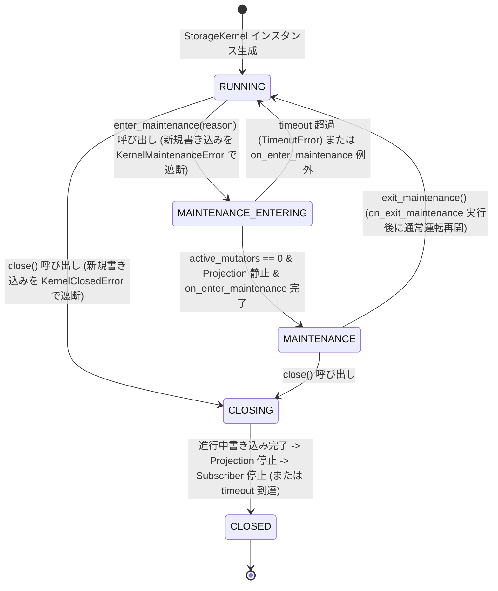
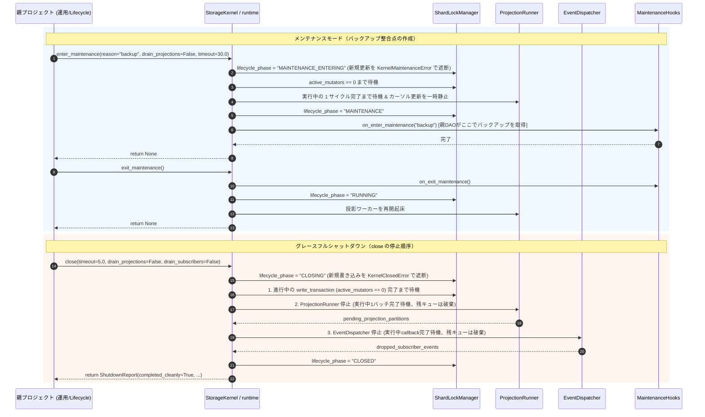

# 詳細設計書（機能・モジュール制御仕様）
**storage_kernel 実行制御（`runtime/concurrency.py`・`runtime/maintenance.py`・`runtime/lifecycle.py`）制御仕様（文書番号: DBF-DD-004）**

---

## 1. 概要とSSOT境界

### 1.1 モジュールの目的

本モジュール群（`runtime/concurrency.py` の `ShardLockManager`、`runtime/maintenance.py` の `MaintenanceCoordinator`、`runtime/lifecycle.py` の `LifecycleManager`）は、マルチスレッド環境下で稼働する `StorageKernel` の排他制御、メンテナンス静止点の作成、および安全なシャットダウン（Graceful Shutdown）を担う（Issue #3 C4・C5、Issue #4 D2）。

1. **パーティション単位ロックと状態遷移の競合防止（`ShardLockManager`）**: `partition_key` 単位の排他ロックとルーティングキャッシュを管理し、`append` / `write_snapshot` の「状態確認〜シャード書き込み」と `set_partition_status` の「状態更新〜キャッシュ更新」を同一ロック内で直列化する。これにより、`read_only` への遷移完了後に並行スレッドの書き込みがすり抜ける競合を完全に防止する。
2. **メンテナンスモード制御（`MaintenanceCoordinator`）**: `enter_maintenance` 呼び出し時にカーネル状態を `MAINTENANCE` へ遷移させ、新規の書き込み・パーティション作成・状態変更・カーソル更新を `KernelMaintenanceError` で即座に遮断する。その上で進行中の書き込みトランザクションと（指定時は）Projection の完了を待機してから `MaintenanceHooks.on_enter_maintenance(reason)` を呼び出し、親プロジェクトが一貫したバックアップを取得できる静止点を作る。
3. **段階的グレースフルシャットダウン（`LifecycleManager`）**: `close()` 呼び出し時にカーネル状態を `CLOSING` → `CLOSED` へ不可逆に遷移させ、①新規書き込みの `KernelClosedError` による即時拒否と進行中書き込みの完了待機 → ② `ProjectionRunner` の停止（既定は実行中の1サイクル完了のみ待機、指定時は最新 `seq` までドレイン）→ ③ `EventDispatcher`（`subscribe`）の停止、の順序で停止させ、結果を `ShutdownReport` として返す。

### 1.2 単一責任範囲 (SSOT) とデータ境界

- **本書の正本範囲**: `module_behavior`。実行制御モジュール群（`runtime/concurrency.py`, `runtime/maintenance.py`, `runtime/lifecycle.py`）の制御フロー、内部 DTO、カーネル全体のライフサイクル状態遷移、エラー処理、および機能テスト要件（`TR-DD4-001`〜`004`）の正本とする。
- **データ境界 (DTO vs DAO)**: 本書はインメモリのロックテーブル、アクティブ操作カウンタ、ライフサイクル状態を管理する。永続化データの排他要件はデータ構造仕様書（[`DBF-DS-001`](./DBF-DS-001_データ構造仕様書.md) 3.3節）を参照する。
- **BDとの関係**: システム全体のアーキテクチャ方針は基本設計書（[`DBF-BD-001`](./DBF-BD-001_基本設計書.md)）を正本とし、本書はコンポーネント `C-006` を具体化する。
- **他文書との関係**: 要求、環境、運用、テスト、ADR、レビュー文書はそれぞれの `ssot_scope` を正本とし、本書の制御仕様を上書きしない。
- **他文書へ委譲する情報**: 品質ゲートは環境・開発基盤仕様書（[`DBF-ENV-001`](../setup/DBF-ENV-001_環境・開発基盤仕様書.md)）、テストケース・実行結果・証跡はテスト計画・結果報告書を正本とし、本書へ再掲しない。
- **外部公開契約**: 公開 API `set_partition_status`（`IF-006`）、`enter_maintenance`（`IF-007`）、`exit_maintenance`（`IF-008`）、`close`（`IF-010`）、および `MaintenanceHooks`（`IF-109`）の外部契約は IF/API仕様書（[`DBF-IF-001`](./DBF-IF-001_IF仕様書.md)）を正本とする。
- **責務の対象外**: バックアップファイルの具体的なコピー手順や復旧訓練手順は運用手順書（OP）へ委譲する。
- **矛盾時の扱い**: 文書の更新日ではなく、該当する `ssot_scope` の正本を更新し、関連文書を追従させる。

---

## 2. インターフェースと DTO (Data Transfer Object) 仕様

### 2.1 対象機能一覧

| 機能ID | 関数・機能名 | 呼び出し元 | 主な呼び出し先 | 同期 / 非同期 | 冪等性 | 外部副作用 | 公開範囲 |
| :--- | :--- | :--- | :--- | :---: | :---: | :--- | :---: |
| F-401 | `ShardLockManager.partition_write_guard` & キャッシュ同期 | `WritePipeline` (`DBF-DD-001` `F-101`, `F-102`), `StorageKernel.set_partition_status` (`F-103`) | `LifecycleManager` 状態確認, パーティション別 `RLock`, ルーティングキャッシュ更新 | 同期（コンテキストマネージャ） | なし（ロック獲得・解放） | インメモリロック獲得とアクティブ Writer カウンタ増減 | 外部公開（`IF-006` の排他基盤） |
| F-402 | `StorageKernel.enter_maintenance` / `MaintenanceCoordinator.enter` | 親プロジェクト運用・バックアップ機能 | `ShardLockManager` バリア待機, `ProjectionRunner.pause_or_drain`, `MaintenanceHooks.on_enter_maintenance` | 同期 | なし（重複呼び出しは `KernelMaintenanceError`） | 全更新操作の遮断と `on_enter_maintenance` フック呼び出し | 外部公開（`IF-007`） |
| F-403 | `StorageKernel.exit_maintenance` / `MaintenanceCoordinator.exit` | 親プロジェクト運用・バックアップ機能 | `MaintenanceHooks.on_exit_maintenance`, `ShardLockManager` バリア解除, `ProjectionRunner` 再開起床 | 同期 | あり（通常運転中は無操作） | `on_exit_maintenance` フック呼び出しと更新遮断の解除 | 外部公開（`IF-008`） |
| F-404 | `StorageKernel.close` / `LifecycleManager.shutdown` | 親プロジェクト Lifecycle 管理 | `ShardLockManager` 新規遮断・進行中待機, `ProjectionRunner.stop`, `EventDispatcher.stop` | 同期 | あり（2回目以降はキャッシュ済み `ShutdownReport` を返却） | 全ワーカースレッドの停止と残キュー破棄/ドレイン | 外部公開（`IF-010`） |

### 2.2 主要関数・機能の契約

#### 機能契約（機能ID: F-401 `ShardLockManager.partition_write_guard` & キャッシュ同期）

- **対象機能・関数名**: `ShardLockManager.partition_write_guard(partition_key)` / `update_cached_partition(info)`
- **機能概要**:
  1. グローバル状態ロック（`threading.Condition`）の下で現在のカーネルライフサイクル状態を確認する。
     - `CLOSING` または `CLOSED` の場合は即座に `KernelClosedError` を送出する。
     - `MAINTENANCE_ENTERING` または `MAINTENANCE` の場合は即座に `KernelMaintenanceError` を送出する。
     - `RUNNING` の場合は `active_mutators`（進行中の書き込み・状態変更・カーソル更新カウンタ）を `+1` する。
  2. 対象 `partition_key` 専用の `threading.RLock` を獲得してコンテキスト内へ入る。
  3. コンテキスト終了時（`finally` 節）に `partition_key` の `RLock` を解放し、グローバル状態ロック下で `active_mutators` を `-1` する。`active_mutators == 0` になった場合は、`enter_maintenance` または `close` で待機中のスレッドへ `notify_all()` を送る。
  4. `set_partition_status` も同じ `partition_write_guard(partition_key)` を獲得して `MetaDAOPort.set_partition_status` とキャッシュ更新を行うため、`read_only` への変更と `append` が完全に直列化される。
- **事前条件 (Pre-conditions)**: `partition_key` が非空文字列であること。
- **事後条件 (Post-conditions)**: コンテキスト内で同一 `partition_key` に対する他の書き込みや状態変更が並行実行されないこと、およびコンテキスト中にメンテナンスモードやシャットダウン完了へ遷移しないことが保証される。
- **タイムアウト / キャンセル**: 同一パーティションの先行トランザクション完了まで待機する。
- **ログ・メトリクス・相関ID**: ロック競合待機時間やキャッシュヒット率を必要に応じて計測する。
- **外部公開時の互換性・認証**: [`DBF-IF-001`](./DBF-IF-001_IF仕様書.md) 4.5節（`IF-006`）を参照。

#### 機能契約（機能ID: F-402 `enter_maintenance` & F-403 `exit_maintenance`）

- **対象機能・関数名**: `StorageKernel.enter_maintenance` / `StorageKernel.exit_maintenance`
- **機能概要**:
  - **`enter_maintenance(reason, *, drain_projections=False, timeout=30.0)`**:
    1. グローバル状態ロック下で状態を確認する。`CLOSING`/`CLOSED` なら `KernelClosedError`、既に `MAINTENANCE_ENTERING`/`MAINTENANCE` なら `KernelMaintenanceError` を送出する。
    2. 状態を `MAINTENANCE_ENTERING` へ変更する（この瞬間から新規の `append`, `write_snapshot`, `set_partition_status`, `resume_projection(skip_current=True)` はすべて `KernelMaintenanceError` で拒否される）。
    3. `active_mutators == 0`（進行中の全書き込みトランザクション完了）になるまで残り `timeout` 秒以内で待機する。
    4. `ProjectionRunner` に対しメンテナンス一時停止を要求する。`drain_projections=False`（既定）の場合は現在実行中の `apply_batch` + `advance_cursor` の1サイクル完了のみを待機する。`drain_projections=True` の場合は全登録済み Projection が最新 `seq` に追いつくまで残り `timeout` 秒以内で待機してからカーソル更新を静止させる。
    5. 待機中に `timeout` を超過した場合は、状態を `RUNNING` に戻して Projection の静止要求を解除し、`TimeoutError` を送出する。
    6. すべての書き込みとカーソル更新が静止したら状態を `MAINTENANCE` へ確定させ、`MaintenanceHooks` が注入されていれば `on_enter_maintenance(reason)` を呼び出す（`on_enter_maintenance` 自体が例外を送出した場合は、ロックを握りっぱなしにしないよう状態を `RUNNING` へロールバックして例外を再送出する）。
  - **`exit_maintenance()`**:
    1. 状態が `MAINTENANCE` でなければ（`RUNNING` なら）何もせず戻る（`CLOSING`/`CLOSED` なら `KernelClosedError`）。
    2. `MaintenanceHooks` が注入されていれば `on_exit_maintenance()` を呼び出す。
    3. `finally` 節で状態を `RUNNING` に戻し、静止していた `ProjectionRunner` ワーカーを再開起床させる。
- **事前条件 (Pre-conditions)**: `reason` が非空文字列、`timeout > 0` であること。
- **事後条件 (Post-conditions)**: `MAINTENANCE` 状態の間、メタDBおよび全シャードDBに対する書き込みとカーソル更新が 0 件であることが保証される。
- **タイムアウト / キャンセル**: `timeout` 秒（既定 30.0 秒）超過時は `TimeoutError` で安全にロールバックする。
- **ログ・メトリクス・相関ID**: `reason`, `drain_projections`, 静止待機時間（秒）をログ・telemetry に記録する。
- **外部公開時の互換性・認証**: [`DBF-IF-001`](./DBF-IF-001_IF仕様書.md) 4.6節（`IF-007`, `IF-008`）を参照。

#### 機能契約（機能ID: F-404 `StorageKernel.close` / `LifecycleManager.shutdown`）

- **対象機能・関数名**: `StorageKernel.close(*, timeout=5.0, drain_projections=False, drain_subscribers=False) -> ShutdownReport`
- **機能概要**:
  1. 既に `CLOSED` で結果が確定している場合は、キャッシュされた `ShutdownReport` を即座に返す（冪等）。
  2. 開始時刻 `start = time.monotonic()` を記録し、グローバル状態を `CLOSING` に遷移させる（この瞬間から新規の `append`, `write_snapshot`, `set_partition_status`, `enter_maintenance`, `subscribe`, `register_projection` はすべて `KernelClosedError` で拒否される）。
  3. **第1段階（進行中書き込みの完了待機）**: `active_mutators == 0` になるまで、残り `timeout` 時間内で待機する。
  4. **第2段階（`ProjectionRunner` の停止）**:
     - `drain_projections=False`（既定）: 現在実行中の `apply_batch` + `advance_cursor` の1サイクル完了のみを残り `timeout` 内で待ち、未処理の Dirty Set・キューは破棄してワーカーを停止する（次回起動時にカーソルから追いつけるため）。
     - `drain_projections=True`: 全アクティブパーティションのカーソルが最新 `seq` に追いつくまで残り `timeout` 内で待ってからワーカーを停止する。
     - 停止時点で未反映差分が残っているパーティションキーを `pending_projection_partitions` として集計する。
  5. **第3段階（`EventDispatcher` / `subscribe` の停止）**:
     - `drain_subscribers=False`（既定）: 現在実行中のコールバック完了のみを残り `timeout` 内で待ち、各購読者キューに残っていた未配信イベントを破棄してその合計件数を `dropped_subscriber_events` に計上する。
     - `drain_subscribers=True`: 全購読者キューが空になるまで残り `timeout` 内で待ってからワーカーを停止する。
  6. 状態を `CLOSED` へ遷移させ、全段階がタイムアウト内に完了したかを `completed_cleanly: bool`、経過時間を `elapsed_sec` に記録した `ShutdownReport` を返す（タイムアウト超過時は警告ログを出力する）。
- **事前条件 (Pre-conditions)**: `timeout >= 0.0` であること。
- **事後条件 (Post-conditions)**: `ShutdownReport` が返り、以降の新規変更操作はすべて `KernelClosedError` となる。
- **タイムアウト / キャンセル**: `timeout`（既定 5.0 秒）を超過しても例外を送出せず、`completed_cleanly=False` の `ShutdownReport` を返して制御を戻す。
- **ログ・メトリクス・相関ID**: `ShutdownReport` の全フィールドをログ・telemetry に記録する。
- **外部公開時の互換性・認証**: [`DBF-IF-001`](./DBF-IF-001_IF仕様書.md) 4.8節（`IF-010`）を参照。

### 2.3 入力 DTO スキーマ・パラメータ仕様

公開 API（`F-401`〜`F-404`）の入力引数は [`DBF-IF-001`](./DBF-IF-001_IF仕様書.md) 4.5〜4.8節を正本とする。ここでは実行制御モジュールが保持する内部状態 DTO を定義する。

- **対象機能ID**: `F-401`〜`F-404`（内部 DTO `RuntimeControlState`）

| フィールド | データ型 | 必須性 | NULL可 | デフォルト値 | バリデーションルール・入力制約 | 例・備考 |
| :--- | :--- | :---: | :---: | :--- | :--- | :--- |
| `lifecycle_phase` | `Literal["RUNNING", "MAINTENANCE_ENTERING", "MAINTENANCE", "CLOSING", "CLOSED"]` | 必須 | 不可 | `"RUNNING"` | 状態遷移図（3.1節）の遷移規則に従う | `"RUNNING"` |
| `active_mutators` | `int` | 必須 | 不可 | `0` | `>= 0`。進行中の書き込み・状態変更トランザクション数 | `0` のときのみ静止点が成立 |
| `partition_locks` | `dict[str, RLock]` | 必須 | 不可 | 空辞書 | `partition_key` ごとの排他ロック | グローバルロック下で遅延生成 |
| `routing_cache` | `dict[str, PartitionInfo]` | 必須 | 不可 | 空辞書 | `partition_key` から `PartitionInfo` へのキャッシュ | `bind_shard` と `set_partition_status` で更新 |
| `maintenance_reason` | `str \| None` | 任意 | 可 | `None` | `MAINTENANCE` 中のみ非空文字列 | `"daily_backup"` |
| `last_shutdown_report` | `ShutdownReport \| None` | 任意 | 可 | `None` | `CLOSED` 到達後にキャッシュされるレポート | 2回目以降の `close()` で返却 |

### 2.4 出力 DTO スキーマ・戻り値仕様

- **対象機能ID**: `F-404`
- **正常時の戻り値 DTO**: `ShutdownReport`（フィールド定義は [`DBF-IF-001`](./DBF-IF-001_IF仕様書.md) 2.3節を正本とする）。
- **異常時の戻り値 / 例外**: `KernelClosedError`, `KernelMaintenanceError`, `PartitionStateConflictError`, `TimeoutError`。
- **再試行可否**: `enter_maintenance` が `TimeoutError` で失敗した場合は再試行可能。`close()` は冪等。
- **相関ID・監査情報**: `maintenance_reason` および `ShutdownReport`。

---

## 3. 処理フロー・シーケンス・状態遷移ロジック (Mermaid 図)

### 3.1 処理フロー・シーケンス / 状態遷移図

- **図の正本**: 状態遷移表（3.2節）および下記の状態遷移図・シーケンス図を併用して正本とする。
- **対象機能ID**: `F-401`〜`F-404`

#### A. StorageKernel ライフサイクルとメンテナンスの状態遷移図 (State Diagram)

#### B. メンテナンスモード遷移と `close()` 停止順序のシーケンス図 (Sequence Diagram)

### 3.2 状態遷移およびルーティングルール

- **初期状態**: `RUNNING`（`StorageKernel` の初期化完了時）。
- **終端状態**: `CLOSED`（一度 `CLOSING` / `CLOSED` に入ったカーネルは二度と `RUNNING` や `MAINTENANCE` へ戻らない）。
- **状態不変条件**:
  - `MAINTENANCE` 状態では `active_mutators == 0` であり、かつすべての `ProjectionRunner` ワーカーが `apply_batch` / `advance_cursor` を実行していない静止状態である。
  - `partition_locks[partition_key]` が保持されている間、同一 `partition_key` の状態変更と書き込みが同時に進行することはない。
- **未定義イベントの扱い**: `MAINTENANCE` 中に `close()` が呼ばれた場合は、メンテナンス状態を終了させて `CLOSING` へ遷移し、安全にシャットダウンできるようにする。

| 現在の状態 / ノード | 実行結果 / 評価フラグ | 次の状態 / ノード | 遷移判定条件・閾値ルール | 副作用・ログ / メトリクス |
| :--- | :--- | :--- | :--- | :--- |
| `RUNNING` | `enter_maintenance` 開始 | `MAINTENANCE_ENTERING` | 進行中トランザクションの完了待ちを開始 | 新規書き込み・状態変更・カーソル更新を `KernelMaintenanceError` で遮断 |
| `MAINTENANCE_ENTERING` | 静止完了 & フック成功 | `MAINTENANCE` | `timeout` 内に `active_mutators == 0` & Projection 静止 & `on_enter_maintenance` 完了 | バックアップ整合点が確立 |
| `MAINTENANCE_ENTERING` | 待機タイムアウト / フック例外 | `RUNNING` | 経過時間 `> timeout` または `on_enter_maintenance` が例外送出 | 遮断を解除して通常運転へ戻し、`TimeoutError` または元例外を送出 |
| `MAINTENANCE` | `exit_maintenance` 完了 | `RUNNING` | `on_exit_maintenance()` を呼び出し完了 | 遮断を解除し、`ProjectionRunner` を起床させる |
| `RUNNING` / `MAINTENANCE` | `close()` 開始 | `CLOSING` | シャットダウン要求 | 新規書き込み等を `KernelClosedError` で即座に拒否 |
| `CLOSING` | 段階的停止完了（または timeout） | `CLOSED` | ①書き込み完了待機 → ②Projection停止 → ③Subscriber停止 | `ShutdownReport` を生成・キャッシュして返却 |
| `CLOSED` | 2回目以降の `close()` | `CLOSED` | 既に停止完了済み | キャッシュ済みの `ShutdownReport` を即座に返却 |

---

## 4. エラー処理・失敗契約

### 4.1 エラー分類と対処方針

| エラーコード / 例外型 | エラーカテゴリ | 発生・判定基準 | 再試行上限 | 再試行安全条件 | 終端ステータス | 利用者・運用者対応 | 副作用・データ保持契約 |
| :--- | :--- | :--- | :---: | :--- | :--- | :--- | :--- |
| `PartitionStateConflictError` | 楽観ロック（CAS）競合 | `set_partition_status` の `expected_status` が現在の `status` と不一致 | 条件付き | 最新状態を `MetaDAOPort.get_partition` 等で確認した上で再実行 | 状態変更拒否 | 他のスレッドによる状態変更を確認する | パーティションの `status` とキャッシュは変更前の値を維持 |
| `KernelMaintenanceError` | メンテナンス中遮断 | `MAINTENANCE_ENTERING` または `MAINTENANCE` 中に書き込み・パーティション作成・状態変更・カーソル更新（または二重の `enter_maintenance`）を呼び出し | 呼び出し側制御 | `exit_maintenance()` 完了後に再実行 | 操作拒否 | メンテナンスモードの終了を待つ | バックアップ中の DB ファイルへの書き込み混入を完全に防ぐ |
| `TimeoutError`（メンテナンス移行） | 静止待機タイムアウト | `enter_maintenance` で `timeout` 秒以内に進行中トランザクションまたは Projection ドレインが終わらない | 可 | トランザクション負荷が下がってから、または `timeout` を延ばして再実行 | `RUNNING` へ自動復帰 | 長時間ロックを保持している DAO トランザクションや Projection を確認する | 自動的に `RUNNING` に戻るためデッドロックや恒久遮断にはならない |
| `KernelClosedError` | シャットダウン後拒否 | `CLOSING` または `CLOSED` 状態で更新系・登録系 API を呼び出し | 0回（不可） | なし | 操作拒否 | プロセス終了処理中として呼び出しを止める | 進行中だった書き込みの完了後は一切のデータ変更が起きない |

---

## 5. 機能テスト要件

機能が保証すべき振る舞いを要件として定義する（Issue #3・#4 の基盤ユニットテスト項目に対応）。具体的なテストケース・実行結果・証跡はテスト計画・結果報告書、品質ゲートは [`DBF-ENV-001`](../setup/DBF-ENV-001_環境・開発基盤仕様書.md) を正本とし、本書へ再掲しない。

### 5.1 機能テスト要件一覧

| 要件ID | 対象機能ID | 保証すべき振る舞い・条件 | 検証観点 | 対応テストケース |
| :--- | :--- | :--- | :--- | :--- |
| TR-DD4-001 | F-401 | **状態遷移と `append` の並行競合防止**: `set_partition_status(partition_key, "read_only")` と `append(partition_key, ...)` を複数スレッドから並行に実行しても、`read_only` への遷移が完了した後に書き込みが成功することが一切ないこと（Issue #3 C5） | 並行性 / 排他制御 | `tests/unit/test_concurrency.py::test_concurrent_status_transition_to_read_only_prevents_subsequent_writes` |
| TR-DD4-002 | F-402 / F-403 | **メンテナンスモードの遮断と進行中トランザクション待機**: `enter_maintenance` 中の書き込み・状態変更・カーソル更新が `KernelMaintenanceError` で拒否され、開始前に進行中だったトランザクションがすべて完了した後に `MaintenanceHooks.on_enter_maintenance` が呼ばれ、`exit_maintenance` 後に通常運転へ戻ること（Issue #4 D2） | 正常 / 異常 / 排他制御 | `tests/unit/test_maintenance.py::test_maintenance_mode_blocks_writes_and_waits_for_in_flight_transactions` |
| TR-DD4-003 | F-404 | **`close()` 開始後の新規書き込み拒否と進行中書き込みの完了保証**: `close()` 開始後に呼ばれた `append` が即座に `KernelClosedError` になり、開始時点で進行中だった `write_transaction` は中断されずに COMMIT まで完了してから停止し、`ShutdownReport` が返ること（Issue #3 C4） | 正常 / 異常 / ライフサイクル | `tests/unit/test_lifecycle.py::test_close_rejects_new_writes_and_completes_in_flight_writes` |
| TR-DD4-004 | F-404 | **`close()` のドレインオプションとタイムアウト制御**: `drain_projections=True` / `drain_subscribers=True` 指定時にキュー処理完了を待ち、タイムアウト超過時はハングアップせず `completed_cleanly=False` と未処理件数を記録した `ShutdownReport` を返すこと（Issue #3 C4） | 境界 / タイムアウト | `tests/unit/test_lifecycle.py::test_close_drain_options_and_timeout_report` |

### 5.2 適用する品質ゲート

- **品質ゲートの正本**: [`DBF-ENV-001 環境・開発基盤仕様書`](../setup/DBF-ENV-001_環境・開発基盤仕様書.md)（4.4節）
- **適用するゲートID**: 全件（`QG-001`〜`QG-006`）
- 本機能だけに必要な条件がある場合は、環境・開発基盤仕様書へゲートを追加してから参照する。本書には実行コマンドや合格基準を記載しない。

---

## 6. 作成完了チェック

- [x] `document_role`、`ssot_scope`、`status`、`owner`をFrontmatterへ設定した。
- [x] 対象機能一覧のIDと、契約・DTO・状態遷移・機能テスト要件のIDが対応している。
- [x] 呼び出し元・呼び出し先、同期方式、冪等性、外部副作用、公開範囲を記入した。
- [x] 外部公開する機能は、IF/API仕様書を参照するか、機能契約に互換性・認証方針を記入した。
- [x] 事前条件、事後条件、タイムアウト、キャンセル、ログ・相関IDを記入した。
- [x] 入力・出力DTOの必須性、NULL可否、制約、異常時形式を記入した。
- [x] 初期状態、終端状態、未定義イベント、状態不変条件を記入した。
- [x] エラーコード/例外型、再試行安全条件、利用者・運用者対応、データ保持契約を記入した。
- [x] 機能テスト要件ごとに検証観点と、テスト計画・結果報告書の対応ケースIDを記入した。
- [x] 品質ゲートは環境・開発基盤仕様書のゲートIDを参照し、実行コマンド・合格基準・テストケースを本書へ再掲していない。
- [x] Mermaidのサンプル状態名・エラー名・閾値および未置換の `[ ... ]` が残っていない。

---

## 7. 改訂履歴 (Change Log)

| 版数    | 改訂日     | 変更者 | 変更内容・変更理由 (Why)                                              |
| :------ | :--------- | :----- | :-------------------------------------------------------------------- |
| Rev.1.0 | 2026-11-19 | xzyozi | 新規作成（Issue #15 に基づき実行制御 runtime/concurrency, maintenance, lifecycle の詳細設計を制定） |
