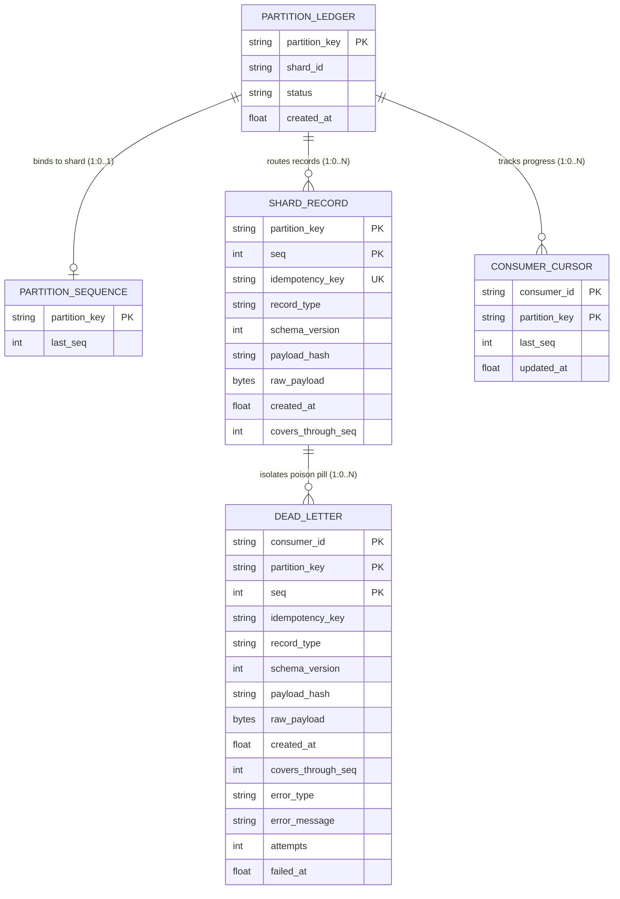

# データ構造仕様書（スキーマ・永続化・状態定義）
**storage_kernel 永続化論理スキーマ・不変条件・状態分類仕様（文書番号: DBF-DS-001）**

---

## 1. 概要とデータ管理方針

### 1.1 管理対象データの目的

`storage_kernel` は物理テーブル定義（DDL）や DB ドライバーを親プロジェクトの DAO へ委譲するため、本書は「親プロジェクトの DAO（および同梱の参照実装 `contrib/sqlite/`）が何を、どの不変条件・耐久性・原子性のもとで保存しなければならないか」という**永続化データの論理スキーマと状態契約**を規定する。

- **管理対象**:
  - **永続化データ（Persistent State）**: パーティション台帳（`PARTITION_LEDGER`）、進捗カーソル（`CONSUMER_CURSOR`）、パーティション連番状態（`PARTITION_SEQUENCE`）、イミュータブル・レコードおよびスナップショット（`SHARD_RECORD`）、隔離された失敗レコード（`DEAD_LETTER`）。
  - **非永続化データ（Volatile In-Memory State）**: 購読者別有界配信キュー、Projection 追いつき用の Dirty Set、パーティションルーティングキャッシュ、パーティションロック。
- **データ形式・文字コード・改行**:
  - 識別子文字列はすべて UTF-8、改行コードは LF を標準とする。
  - ペイロード本体は `PayloadCodec[T].encode` が出力した決定論的バイト列（または UTF-8 JSON 文字列等、DAO が選択したバイナリ/テキスト表現）として保存し、エンコード後の最大サイズを **64 KB（65,536 bytes）** とする（スナップショット `__snapshot__` を含む。Issue #1 A3、Issue #4 D1）。
- **時刻の基準**:
  - 保存されるすべてのタイムスタンプ（`created_at`, `updated_at`, `failed_at`）は UTC エポック秒（倍精度浮動小数点 `REAL` / `float`）とする。
- **スキーマの正本形式**:
  - 本書第2章の論理エンティティ定義および不変条件表を正本とする。第2.4節に示す `contrib/sqlite/` の物理スキーマ表は参照実装の構成例であり、親プロジェクトの物理テーブル構造を拘束しない（Issue #1 A4、Issue #3 C5）。
- **機密性・個人情報分類**:
  - 基盤はペイロードの中身を関知せず封筒（`RecordEnvelope[T]`）として扱う。個人情報や機密データの暗号化・マスキングが必要な場合は、親プロジェクトが `PayloadCodec[T]` または DAO Adapter 層で実施する。

### 1.2 データ境界 (DAO / 永続化ストレージ正本)

- **本書の正本範囲**: `persistent_data`。ストレージに永続化される論理データ構造、状態分類、一意性・単調性などのデータ不変条件、耐久性（`durability`）、トランザクション原子性、読み取り時スキーマ移行（Upcast のデータ不変則）、およびバックアップ対象の正本とする。
- **DTOとの使い分け**: 親プロジェクトとの境界で受け渡す契約型・メソッド引数は IF/API仕様書（[`DBF-IF-001`](./DBF-IF-001_IF仕様書.md)）、モジュール内部の制御用 DTO は詳細設計書（`DBF-DD-001`〜`004`）を正本とする。
- **DDとの関係**: モジュールの呼び出し順序、制御フロー、リトライ・状態遷移ロジックは詳細設計書（`DBF-DD-001`〜`004`）を正本とし、本書は保存形式と永続化契約を定義する。
- **他文書との関係**: 環境・品質ゲートは [`DBF-ENV-001`](../setup/DBF-ENV-001_環境・開発基盤仕様書.md)、設計判断の理由は `ADR-002`〜`ADR-005` を正本とし、本書の保存仕様を上書きしない。
- **責務の対象外**: 具象 SQL コード（`CREATE TABLE` 文などのソースコードブロック）は本書に掲載せず、すべて構造化テーブルと Mermaid ER 図で表現する。
- **矛盾時の扱い**: 文書の更新日ではなく、該当する `ssot_scope` の正本を更新し、関連文書を追従させる。

### 1.3 状態の分類（永続データと非永続データ）および配置構造

システム内のデータを「永続化が必須の正本データ」と「プロセス再起動時に破棄・再構築される揮発データ」に明確に分類する（Issue #2 B2）。物理ファイルの配置先は親プロジェクトの DAO（または `contrib/sqlite/` の `base_dir`）が管理する。

| データ種別 | 永続化区分 | 論理配置先 / 参照実装ファイル例 | 保持内容 | 所有者・アクセス境界 | 保持・バックアップ・復旧方針 |
| :--- | :---: | :--- | :--- | :--- | :--- |
| パーティション台帳 (`PARTITION_LEDGER`) | **永続**（Source of Truth） | メタストレージ（例: `meta.db`） | `partition_key` と格納先 `shard_id` の不変バインド、および `status`（`active` / `read_only`） | `MetaDAOPort` 実装（単一プロセス占有） | 無期限保持。バックアップ必須対象（シャードと同一世代で取得） |
| 進捗カーソル (`CONSUMER_CURSOR`) | **永続**（Source of Truth） | メタストレージ（例: `meta.db`） | `(consumer_id, partition_key)` ごとの最終適用済み `last_seq` | `MetaDAOPort` 実装（単一プロセス占有） | 無期限保持。バックアップ必須対象（Projection 再構築時は新規 `consumer_id` で再生） |
| パーティション連番・レコード本体 (`PARTITION_SEQUENCE`, `SHARD_RECORD`) | **永続**（Source of Truth） | シャードストレージ群（例: `shard_0.db`〜`shard_N.db`） | パーティション別最新連番と、通常レコードおよび `__snapshot__` レコード | `ShardDAOPort` 実装（単一プロセス占有） | v1 は無期限保持（Retention は v2）。全シャードがバックアップ必須対象 |
| Dead Letter (`DEAD_LETTER`) | **永続**（任意 Port 導入時） | メタまたは専用 DLQ ストレージ（例: `meta.db`） | Projection のリトライ上限を超えた Poison Pill レコードと失敗原因 | `DeadLetterPort` 実装 | 運用者が原因解消・再処理するまで保持。バックアップ対象に含める |
| 非同期投影ビュー (`PROJECTION_VIEW`) | **派生永続**（再構築可能） | 投影ストレージ（例: `projection.db`） | FTS5 全文検索インデックスや集計マテビューなど、親が管理する参照特化データ | `ProjectionPort` 実装 | シャードの `seq=0` または最新 `__snapshot__` から再構築可能。第4.2節の4条件をすべて満たす場合のみバックアップ対象から除外可 |
| ルーティングキャッシュ | **非永続**（メモリ揮発） | プロセス内メモリ（`runtime/`・`core/`） | `partition_key -> PartitionInfo` のインメモリ辞書 | `StorageKernel` プロセス内 | 再起動時に破棄し、`MetaDAOPort.get_partition` / `list_partitions` から再ロードする |
| Event Bus 有界キュー | **非永続**（メモリ揮発） | プロセス内メモリ（`core/event_bus.py`） | `subscribe` 購読者ごとの未配信イベントキュー | `EventDispatcher` | At-Most-Once のため再起動・`close()` 時に破棄する |
| Projection Dirty Set | **非永続**（メモリ揮発） | プロセス内メモリ（`core/projection.py`） | Fast Path キュー溢れや通知取りこぼしが発生した `partition_key` の集合 | `ProjectionRunner` | 再起動時に破棄。起動時は `MetaDAOPort.list_partitions` と `get_cursor` から全パーティションの未処理差分を `fetch_range` で自動走査して追いつく |

---

## 2. データ構造およびスキーマ定義 (Mermaid データモデル図)

### 2.1 エンティティ関係・データモデル構造 (Mermaid ER図)

DAO が永続化すべき論理エンティティと、それらの主キー（PK）・一意制約（UK）・論理参照関係を以下の Mermaid ER 図で定義する。`PARTITION_LEDGER` と `SHARD_RECORD` は別トランザクション境界（メタストレージとシャードストレージ）に属するため、物理外部キーではなく `bind_shard` 先行契約によって参照整合性を保証する。

### 2.2 論理データモデル・フィールド仕様

各論理エンティティのフィールド名、データ型、必須性、NULL可否、既定値、制約条件、および互換性ルールを下表に定義する。

| エンティティ / フィールド名 | 論理データ型 | 必須性 | NULL可 | デフォルト値 | 許容値・制約条件 | 互換性・移行メモ |
| :--- | :--- | :---: | :---: | :--- | :--- | :--- |
| `PARTITION_LEDGER.partition_key` | 文字列 (`str`) | 必須 | 不可 | なし | 主キー（PK）。非空 UTF-8 文字列 | 不変 |
| `PARTITION_LEDGER.shard_id` | 文字列 (`str`) | 必須 | 不可 | なし | 非空文字列。初回 `bind_shard` で確定した後は**不変** | v2 でパーティション移動を導入するまで更新禁止 |
| `PARTITION_LEDGER.status` | 文字列 (`str`) | 必須 | 不可 | `"active"` | `"active"` または `"read_only"` のみ（v1） | v2 で `"migrating"` を追加予定 |
| `PARTITION_LEDGER.created_at` | 浮動小数点 (`float`) | 必須 | 不可 | なし | UTC エポック秒（`> 0`） | 初回登録時の時刻を保持 |
| `CONSUMER_CURSOR.consumer_id` | 文字列 (`str`) | 必須 | 不可 | なし | 複合主キー（PK1）。`ProjectionPort.consumer_id` 等 | Projection 再構築時は新世代 ID を採番 |
| `CONSUMER_CURSOR.partition_key` | 文字列 (`str`) | 必須 | 不可 | なし | 複合主キー（PK2）。対象パーティションキー | - |
| `CONSUMER_CURSOR.last_seq` | 整数 (`int`) | 必須 | 不可 | `0` | `>= 0`。**単調非減少（`MAX(current, seq)`）** | 後退（小さい値での上書き）は厳禁 |
| `CONSUMER_CURSOR.updated_at` | 浮動小数点 (`float`) | 必須 | 不可 | なし | 最終更新 UTC エポック秒 | - |
| `PARTITION_SEQUENCE.partition_key` | 文字列 (`str`) | 必須 | 不可 | なし | 主キー（PK）。シャード内のパーティション識別子 | `SHARD_RECORD` の `MAX(seq)` で代替実装してもよいが、ロールバック原子性を満たすこと |
| `PARTITION_SEQUENCE.last_seq` | 整数 (`int`) | 必須 | 不可 | `0` | 初回採番で `1`、以降 `+1` ずつ厳密単調増加（欠番なし） | トランザクション失敗時は採番増分もロールバックされること |
| `SHARD_RECORD.partition_key` | 文字列 (`str`) | 必須 | 不可 | なし | 複合主キー（PK1）かつ複合一意制約（UK1）の第1列 | パーティション間で冪等キースコープを分離 |
| `SHARD_RECORD.seq` | 整数 (`int`) | 必須 | 不可 | なし | 複合主キー（PK2）。`>= 1`、パーティション内で連番・欠番なし | 一意制約違反時は `DuplicateKeyError(kind="sequence")` |
| `SHARD_RECORD.idempotency_key` | 文字列 (`str`) | 必須 | 不可 | なし | `(partition_key, idempotency_key)` で複合一意制約（UK1） | 一意制約違反時は `DuplicateKeyError(kind="idempotency_key")` |
| `SHARD_RECORD.record_type` | 文字列 (`str`) | 必須 | 不可 | なし | 非空文字列。`"__"` 始まりはシステム予約（`__snapshot__` 等） | - |
| `SHARD_RECORD.schema_version` | 整数 (`int`) | 必須 | 不可 | なし | `>= 1`。書き込み時点の `schema_registry[record_type]` | 保存後は書き換えず、読み取り時に Upcast する |
| `SHARD_RECORD.payload_hash` | 文字列 (`str`) | 必須 | 不可 | なし | 64文字の16進文字列（SHA-256）。長さプレフィックス付き `(record_type, schema_version, raw_payload)` から算出 | 保存時の元データのハッシュ。Upcast 後も決して再計算・上書きしない |
| `SHARD_RECORD.raw_payload` | バイト列 (`bytes`) または文字列 | 必須 | 不可 | なし | `PayloadCodec.encode` の出力。最大 **64 KB（65,536 bytes）** | スナップショット（`__snapshot__`）にも同じ 64 KB 上限を適用 |
| `SHARD_RECORD.created_at` | 浮動小数点 (`float`) | 必須 | 不可 | なし | 書き込みトランザクション開始時の UTC エポック秒 | - |
| `SHARD_RECORD.covers_through_seq` | 整数 (`int`) | 任意 | 可 | `NULL` (`None`) | `record_type == "__snapshot__"` のときのみ非 NULL 必須（`1 <= covers_through_seq <= 当該時点の最終seq`）。通常レコードは NULL | v2 の Retention 削除境界算出の基準値となる |
| `DEAD_LETTER.consumer_id` | 文字列 (`str`) | 必須 | 不可 | なし | 複合主キー（PK1）。失敗した Projection の識別子 | - |
| `DEAD_LETTER.partition_key` / `seq` | 文字列 / 整数 | 必須 | 不可 | なし | 複合主キー（PK2, PK3）。隔離されたレコードの識別子 | 同一 Poison Pill の再隔離に対して冪等（上書きまたは維持） |
| `DEAD_LETTER.idempotency_key`〜`covers_through_seq` | （`SHARD_RECORD` と同一） | 必須 | 条件付 | なし | 原因となった `RecordEnvelope` の全属性を保持する | - |
| `DEAD_LETTER.error_type` / `error_message` | 文字列 (`str`) | 必須 | 不可 | なし | 最終失敗時の例外型名とエラーメッセージ | - |
| `DEAD_LETTER.attempts` | 整数 (`int`) | 必須 | 不可 | なし | 実行された試行回数（`>= 1`） | - |
| `DEAD_LETTER.failed_at` | 浮動小数点 (`float`) | 必須 | 不可 | なし | DLQ 格納時の UTC エポック秒 | - |

### 2.3 論理スキーマの不変条件と違反時の扱い

DAO および基盤コアが常に維持しなければならないデータ不変条件と、違反検出時の扱いを下表に定める（Issue #2・#3・#4・#14）。

| 不変条件ID | 対象エンティティ | 不変条件の内容 | 違反検出箇所と違反時の扱い | 対応Contract Test / DD |
| :--- | :--- | :--- | :--- | :--- |
| INV-DS-001 | `SHARD_RECORD` | **連番の一意性と厳密単調増加**: 同一 `partition_key` 内で `seq` は `1, 2, 3, ...` と1ずつ増加し、重複・欠番・逆転が存在してはならない | トランザクション失敗時は `PARTITION_SEQUENCE` ごとロールバックして欠番を防ぐ。万一 `(partition_key, seq)` 重複が起きた場合は DAO が `DuplicateKeyError(kind="sequence")` を送出する | `TR-IF-001`, `TR-IF-003`, `TR-IF-005` |
| INV-DS-002 | `SHARD_RECORD` | **冪等キーの一意性とペイロード整合**: 同一 `partition_key` 内で `idempotency_key` は一意であり、同一キーに対する `payload_hash` は不変でなければならない | 既存レコードと `payload_hash` が一致すれば新規挿入せず `status="duplicate"` を返す。不一致なら `IdempotencyConflict` を送出し既存データを保護する。DB制約違反時は DAO が `DuplicateKeyError(kind="idempotency_key")` に変換する | `TR-IF-004`, `TR-IF-005`, `TR-IF-006`, `DBF-DD-001` |
| INV-DS-003 | `SHARD_RECORD` | **ペイロードサイズ上限と予約種別保護**: `raw_payload` は 64 KB（65,536 bytes）以下であること。通常 `append` で `"__"` 始まりの `record_type` を保存してはならず、`__snapshot__` は `1 <= covers_through_seq <= 最新seq` を満たすこと | シャード書き込み前に `core/ingestion.py` が検査し、64 KB 超過は `PayloadTooLarge`、予約種別違反は `ReservedRecordTypeError`、`covers_through_seq` 不正は `ValueError` で拒否する（`seq` は一切進まない） | `DBF-DD-001` |
| INV-DS-004 | `PARTITION_LEDGER` / `SHARD_RECORD` | **孤児データの禁止とバインド不変性**: `PARTITION_LEDGER` に未登録の `partition_key` のレコードが `SHARD_RECORD` に存在してはならない。また一度バインドされた `shard_id` は v1 では変更できない | 必ず `bind_shard` を先に COMMIT してから `write_transaction` を実行する（空パーティションは許容）。既登録パーティションへの `bind_shard` は上書きせず既存 `PartitionInfo` を返す | `TR-IF-007`, `TR-IF-008`, `DBF-DD-001` |
| INV-DS-005 | `PARTITION_LEDGER` | **読み取り専用状態の保護と CAS 遷移**: `status == "read_only"` のパーティションには新規レコードもスナップショットも追加してはならない | パーティションロック下で状態を確認し、`read_only` なら `PartitionReadOnlyError` で拒否する。状態変更時の `expected_status` 不一致は `PartitionStateConflictError` で拒否する | `TR-IF-012`, `DBF-DD-001`, `DBF-DD-004` |
| INV-DS-006 | `CONSUMER_CURSOR` | **カーソルの単調非減少**: 任意の `(consumer_id, partition_key)` について、`last_seq` は後退（減少）してはならず、`apply_batch` 成功前に進めてはならない | `MetaDAOPort.advance_cursor` は `MAX(current_seq, seq)` で更新する。`apply_batch` が例外を送出した場合は `advance_cursor` を呼ばない | `TR-IF-009`, `TR-IF-010`, `DBF-DD-002` |
| INV-DS-007 | `SHARD_RECORD` | **保存済みレコードとハッシュの不変性**: 一度永続化されたレコードの `raw_payload`、`schema_version`、`payload_hash` は後から書き換えてはならない | スキーマ移行は読み取り時のメモリ上 Upcast で行い、DB 上の行は更新しない。変換不能または未来の未知版は `SchemaVersionError` で拒否する | `TR-IF-013`, `DBF-DD-003` |

### 2.4 参照実装（`contrib/sqlite/`）の物理スキーマ構成（参考）

同梱の SQLite 参照実装（`contrib/sqlite/meta_dao.py` および `shard_dao.py`）が使用する物理テーブル構成を下表に示す。**本表は参照実装の仕様であり、親プロジェクトが独自のテーブル構造や別 DB エンジン（PostgreSQL 等）を採用することを一切妨げない**（Issue #1 A4、Issue #14）。

| DBファイル区分 | 物理テーブル名 | カラム構成（SQLite 型） | 主キー・一意制約・インデックス |
| :--- | :--- | :--- | :--- |
| メタDB (`meta.db`) | `partitions` | `partition_key TEXT NOT NULL`, `shard_id TEXT NOT NULL`, `status TEXT NOT NULL DEFAULT 'active'`, `created_at REAL NOT NULL` | `PRIMARY KEY (partition_key)`, `CHECK (status IN ('active', 'read_only'))` |
| メタDB (`meta.db`) | `cursors` | `consumer_id TEXT NOT NULL`, `partition_key TEXT NOT NULL`, `last_seq INTEGER NOT NULL`, `updated_at REAL NOT NULL` | `PRIMARY KEY (consumer_id, partition_key)` |
| メタDB (`meta.db`) | `dead_letters` | `consumer_id TEXT NOT NULL`, `partition_key TEXT NOT NULL`, `seq INTEGER NOT NULL`, `idempotency_key TEXT NOT NULL`, `record_type TEXT NOT NULL`, `schema_version INTEGER NOT NULL`, `payload_hash TEXT NOT NULL`, `payload BLOB NOT NULL`, `created_at REAL NOT NULL`, `covers_through_seq INTEGER`, `error_type TEXT NOT NULL`, `error_message TEXT NOT NULL`, `attempts INTEGER NOT NULL`, `failed_at REAL NOT NULL` | `PRIMARY KEY (consumer_id, partition_key, seq)` |
| シャードDB (`shard_*.db`) | `sequences` | `partition_key TEXT NOT NULL`, `last_seq INTEGER NOT NULL DEFAULT 0` | `PRIMARY KEY (partition_key)` |
| シャードDB (`shard_*.db`) | `records` | `partition_key TEXT NOT NULL`, `seq INTEGER NOT NULL`, `idempotency_key TEXT NOT NULL`, `record_type TEXT NOT NULL`, `schema_version INTEGER NOT NULL`, `payload_hash TEXT NOT NULL`, `payload BLOB NOT NULL`, `created_at REAL NOT NULL`, `covers_through_seq INTEGER` | `PRIMARY KEY (partition_key, seq)`, `UNIQUE (partition_key, idempotency_key)` |

---

## 3. 永続化・原子性契約・排他制御

### 3.1 耐久性水準（`durability`）と Write-Before-ACK 契約

DAO は自身の永続化保証レベルを `DurabilityLevel` として宣言し、`ShardDAOPort.write_transaction` の正常終了（COMMIT）時点でその水準を満たさなければならない（Issue #2 B1、[`ADR-004`](../adr/ADR-004_耐久性レベルの自己申告方式とシャードバインド先行の原子性契約.md)）。

| `durability` 水準 | 保証される耐久性 | 参照実装 / テスト実装での設定 | 用途と制約 |
| :--- | :--- | :--- | :--- |
| `"power_loss"`（既定） | プロセス強制終了に加え、OSクラッシュや電源断が発生しても、`write_transaction` を抜けて `WriteAck` を返したレコードおよびメタデータは失われない | `contrib/sqlite/` の既定値（`PRAGMA journal_mode=WAL;` + `PRAGMA synchronous=FULL;`） | 本番環境の既定水準。毎回の COMMIT でディスク同期（`fsync`）が完了する |
| `"process_crash"` | アプリケーションプロセスの突然死（SIGKILL 等）には耐えるが、OSパニックや電源断では直近の COMMIT が失われる可能性がある | 親プロジェクトが性能優先で明示的にオプトアウトした場合（例: SQLite `WAL` + `synchronous=NORMAL`） | 親プロジェクトがリスクを受容して明示宣言した場合のみ使用可 |
| `"none"` | メモリ上のみの保持であり、プロセス終了・再接続で全データが消失する | `testing/memory_ports.py`（In-Memory 実装） | 単体テスト専用。起動時ログ・telemetry に記録し、本番での誤用を判別可能にする |

### 3.2 原子的書き込みとトランザクション境界契約

直接のフラットファイル置換ではなく、DAO のトランザクション機能を通じて以下の5段階の原子性と復旧契約を実現する（Issue #2 B4・B5）。

1. **シャードバインドの先行確定（Meta トランザクション）**:
   - 新規またはキャッシュ未登録の `partition_key` に書き込む際、必ず `MetaDAOPort.bind_shard(partition_key, shard_id)` を先に呼び出してメタストレージへ確定（COMMIT）させる。
   - 2相コミット（2PC）は使用しない。`bind_shard` 成功後にシャード書き込みが失敗した場合、メタ側に「レコード 0 件の空パーティション」が残ることを許容し、逆にメタ未登録の孤児シャードレコードが作られることを完全に防ぐ。
2. **単一シャード内の原子的書き込み（Shard トランザクション）**:
   - `ShardDAOPort.write_transaction(shard_id)` 内で、① `find_by_idempotency`（重複確認）→ ② `next_sequence`（連番採番）→ ③ `insert_record`（レコード保存）を **単一の排他トランザクション**（SQLite 参照実装では `BEGIN IMMEDIATE`〜`COMMIT`）として実行する。
3. **物理書き込み保証（Write-Before-ACK）**:
   - `write_transaction` のコンテキストを抜ける時点で、DAO は宣言した `durability`（既定 `power_loss`）に従ってディスクへの物理同期を完了させる。同期または COMMIT に失敗した場合は即座に例外を送出し、呼び出し元へ `WriteAck` を返さず、Event Bus への投入も行わない。
4. **例外時の完全ロールバック**:
   - トランザクション内で一意制約違反（`DuplicateKeyError`）や I/O エラーが発生した場合、DAO はトランザクション全体を `ROLLBACK` し、`PARTITION_SEQUENCE` の採番増分と `SHARD_RECORD` の挿入をともに巻き戻す（欠番を残さない）。
5. **再起動後の復旧確認**:
   - プロセス再起動後、`ProjectionRunner` は `MetaDAOPort.list_partitions()` と `get_cursor()` を照会し、各シャードの `fetch_range()` から未投影レコードを再取得して整合状態を自動回復する。

- **文字コード・改行・スキーマバージョン**: `payload_hash` は保存時の `record_type`（UTF-8）、`schema_version`（10進文字列または固定長整数表現）、および `PayloadCodec.encode(payload)` の出力バイト列をそれぞれ長さプレフィックス付きで連結した SHA-256（小文字16進64文字）として記録する。

### 3.3 排他制御仕様（インメモリロックとDB排他制御）

- **ロック対象と階層**:
  1. **プロセス内パーティションロック（`ShardLockManager`）**: `runtime/concurrency.py` が管理する `partition_key` 単位の `threading.RLock`（または同等の排他ロック）およびメンテナンスモード用の Read-Write バリア。
  2. **ストレージ層の排他トランザクション**: DAO が管理するシャード単位・メタDB単位のトランザクションロック（SQLite 参照実装では `BEGIN IMMEDIATE` と `PRAGMA busy_timeout=5000`）。
- **ロック獲得と競合防止方針**:
  - `append` / `write_snapshot` の「パーティション状態（`active` / `read_only`）の確認〜シャード書き込み」と、`set_partition_status` の「状態遷移〜ルーティングキャッシュ更新」は、同一の `partition_key` ロックを獲得して直列化する（Issue #3 C5）。これにより、`read_only` への遷移完了後に古いキャッシュを見た書き込みが通過する競合を防ぐ。
  - `enter_maintenance` は新規の書き込みロック獲得をすべて遮断し、進行中の全書き込みロックが解放されるのを最大 `timeout` 秒（既定 30.0 秒）待機する。
- **取得失敗・タイムアウト時の処理**:
  - メンテナンス移行待機が `timeout` を超えた場合は待機を中止して通常モードへ戻し、`TimeoutError` を送出する。
  - DB トランザクションロックの待機タイムアウト時は DAO が例外を送出し、`write_transaction` のロールバック契約に従って安全に失敗する。
- **別プロセスからのアクセス禁止と例外（stale lock 回避）**:
  - v1 は単一プロセスモデルであり、通常運転中に別プロセスが DB ファイルへ直接アクセスしないことを親プロジェクトの規約とする（Issue #1 A2）。
  - 例外として、`enter_maintenance` で `on_enter_maintenance` フックが実行されている静止期間中に限り、バックアッププロセスによる読み取り専用アクセス（ファイルコピーまたは SQLite Backup API）を許可する（Issue #4 D2）。

---

## 4. データライフサイクルと互換性保全

### 4.1 フォーマット移行（読み取り時 Upcast）と互換性ルール

保存済みレコードのペイロード構造がバージョンアップした際、ストレージ上の既存レコードを一括更新（バッチ書き換え）することは行わず、読み取り時に `PayloadUpcaster` で1版ずつ変換する（Issue #4 D3、[`ADR-005`](../adr/ADR-005_v1スコープの限定と将来拡張に向けた前方互換契約の先行定義.md)）。

| 移行元バージョン | 移行先バージョン | 実行契機 | 変換内容・保持する旧フィールド | ロールバック可否・方法 | 失敗時の扱い |
| :--- | :--- | :--- | :--- | :--- | :--- |
| `schema_version = k`（旧版） | `schema_version = k + 1`（最終的に `schema_registry[record_type]` の最新版 `N` まで連鎖実行） | `sync()`、`ProjectionRunner` の `fetch_range()`、スナップショット復元時の読み取り時 | `PayloadUpcaster.upcast(record_type, k, raw_bytes)` を `k` から `N-1` まで1版ずつ適用し、最後に1回だけ `PayloadCodec.decode` を呼ぶ。**DB上の元レコードと `payload_hash` は一切変更しない** | 可（DB上の保存データは書き換えていないため、元データは常に無傷で保持されている） | 未知の版（`> N`）や変換経路の欠落は推測せず即座に `SchemaVersionError` を送出して停止する |

- **旧バージョン互換と不変則**:
  - 旧版のバイト列は最新版の `PayloadCodec.decode` ではパースできない場合があるため、`PayloadUpcaster` はデコード前のバイト列（`bytes -> bytes`）を受け渡す。
  - `RecordEnvelope.payload_hash` は保存時の元データに対する署名であるため、Upcast 後も**再計算せず保存時の値をそのまま維持する**。
  - スナップショット（`record_type == "__snapshot__"`）に対しても、通常レコードと同一の `schema_version` 管理と Upcast 規約を適用する。
  - Downcast（新しい版から古い版への逆変換）は提供しない。
- **後方互換性維持と破壊的変更の境界**:
  - 新しい `schema_version` と対応する `PayloadUpcaster` の追加は後方互換な変更として扱う。
  - 過去の版の `PayloadUpcaster` の削除、同一版番号の意味変更、保存済みデータと非互換な `PayloadCodec` の変更は破壊的変更として禁止する（Retention 導入後に該当版のレコードが全消滅し、バックアップ保持期間も過ぎた後にのみ削除可）。

### 4.2 バックアップ対象と Projection 除外条件

バックアップと復旧の具体的な実行手順は運用手順書（OP）で定義するが、データ整合性を保証するためにバックアップ対象に含めるべきデータ構造の条件を本書で規定する（Issue #4 D2）。

1. **必須バックアップ対象（同一世代での取得が必須）**:
   - メタストレージ全体（`PARTITION_LEDGER`, `CONSUMER_CURSOR`, およびメタ内に配置された `DEAD_LETTER`）。
   - すべてのシャードストレージ（`shard_0`〜`shard_N` の `PARTITION_SEQUENCE`, `SHARD_RECORD`）。
   - バックアップマニフェスト（DBスキーマバージョン、カーネルとDAOのバージョン、全対象ファイルの一覧・バイトサイズ・SHA-256等のチェックサム、および未ドレイン時は各 Projection のカーソル位置）。
   - 取得時は必ず `enter_maintenance` により全書き込みとカーソル更新を静止させた整合点で取得する。
2. **Projection（`PROJECTION_VIEW`）をバックアップ対象から外せる条件**:
   - 以下の**4条件をすべて満たす場合のみ**、Projection DB をバックアップ対象から除外し、復旧時にシャードログまたはスナップショットから再構築する運用を選択できる（1つでも満たさない場合は Projection DB も同一整合点でバックアップ対象に含める）：
     1. 保持しているシャードのレコードまたはスナップショットから完全に再構築できること。
     2. `__snapshot__` を起点として再構築できること（`include_snapshots=True` に対応していること）。
     3. 再構築手順がテストまたは月次の復旧訓練で実証されていること。
     4. 目標復旧時間（RTO）内に全件（またはスナップショットからの差分）の再構築が完了すること。
   - **再構築時のカーソル規約**: Projection をログ／スナップショットから再構築する際は、単調非減少である既存の `consumer_id` のカーソルを巻き戻さず、**新しい Projection 世代と新しい `consumer_id`（例: `fts_index_v2`）で `seq=0`（またはスナップショット位置）から再生し、完了後に参照先を切り替える**。

---

## 5. 作成完了チェック

- [x] `document_role`、`ssot_scope`、`status`、`owner`をFrontmatterへ設定した。
- [x] 管理対象、データ形式、文字コード、時刻基準、スキーマの正本形式を記入した。
- [x] 全エンティティがER図とフィールド仕様の双方に定義され、関係・カーディナリティが一致している。
- [x] 必須性、NULL可否、既定値、列挙値、制約、一意性、サイズ上限を記入した。
- [x] ファイルの相対パス、所有者・アクセス権、保持期間、バックアップ・復旧を記入した。
- [x] 原子書き込みの同期・置換・失敗・清掃・復旧契約を記入した。
- [x] FileLock（パーティションロック・トランザクション排他）の取得、待機、解放、異常終了時の扱いを記入した。
- [x] バージョン移行、後方互換性、ロールバック、移行失敗時の扱いを記入した。
- [x] Mermaidのサンプルエンティティ・フィールド・関係および未置換の `[ ... ]` が残っていない。

---

## 6. 改訂履歴 (Change Log)

| 版数    | 改訂日     | 変更者 | 変更内容・変更理由 (Why)                                                           |
| :------ | :--------- | :----- | :--------------------------------------------------------------------------------- |
| Rev.1.0 | 2026-11-19 | xzyozi | 新規作成（Issue #14 に基づき永続化論理スキーマ、不変条件、耐久性・原子性、バックアップ対象を制定） |
